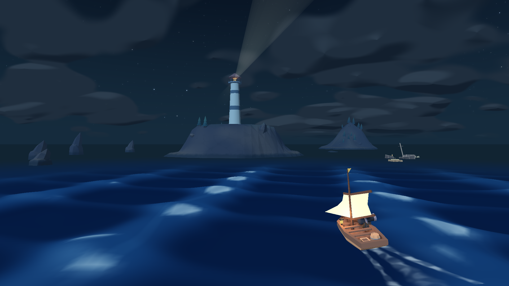
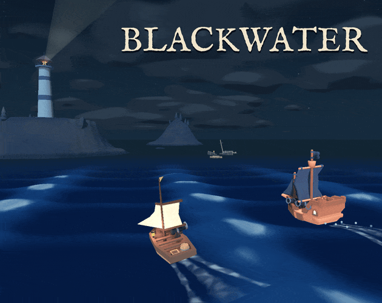
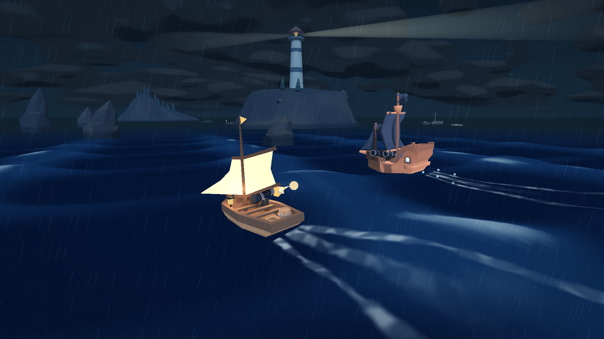
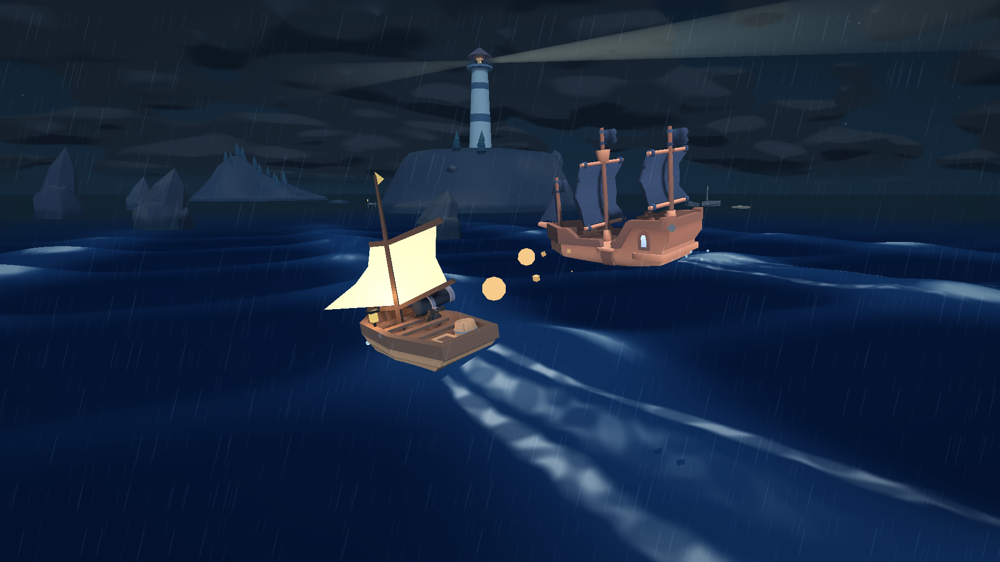

# Blackwater

**Five waves. One lighthouse. A rather large ship waiting at the end.**

A moonlit arcade naval brawl by **Kickflip Games**, made for **Ludum Dare 60**.
Steer a small sailboat through rolling seas, dodge incoming cannon fire, and bring
enemies alongside your starboard gun. Survive the fleet and sink the flagship.

**[Play in your browser on itch.io](https://avivajpeyi.itch.io/blackwater)** ·
**[Ludum Dare entry](https://ldjam.com/events/ludum-dare/60/blackwater)** ·
[Credits](CREDITS.md) · [Changelog](changelog.md)



## Take the helm

- Sail automatically; steer, boost and fire together to line up a broadside.
- Fight cutters, fast skiffs and heavy minelayers across five enemy waves.
- Weave between reefs, wreckage and mines. Catch cyan currents for lasting speed boosts.
- Ride out the swells, protect your hull and take on the final flagship.

<p align="center">
  
</p>

*Captured in the game's Marketing Studio using its real ships, ocean and combat
systems. These staged shots hide gameplay HUD and guides.*

## Controls

Play with a **keyboard and mouse**, or turn a touchscreen phone to **landscape**.
Choose **Tutorial** on the title menu for guided practice.

On touchscreens: **drag left** to steer, **hold FIRE** to shoot, **swipe** the open
water to look, and **hold BOOST** to speed up. Tap **II** to pause.

| Input | Action |
| --- | --- |
| A / D or Left / Right arrows | Steer; forward sailing is automatic |
| Mouse | Look around |
| Space / Left click | Fire the starboard cannon; hold to repeat |
| W / Shift (hold) | Boost |
| E | Toggle chase / close cannon view |
| Esc | Pause / resume |
| M | Mute |
| R (hold) | Restart; after sinking, press R to retry the current wave |

## On the water

| Broadside combat | The flagship |
| --- | --- |
|  |  |

## Run locally

1. Clone this repository.
2. Open **`ldjam_60/project.godot`** in **Godot 4.8** with the Compatibility renderer.
3. Press **F5** to launch the game (`res://game/crossing.tscn`).

From the repository root, with Godot on your PATH:

```sh
godot --path ldjam_60
```

The current game is the lighthouse combat arena. The earlier sailing voyage is
retained as an explicit legacy scene; see the [development guide](DEVELOPMENT.md).
The browser release may lag the latest source changes.

## Development

- [Gameplay, tuning and validation reference](DEVELOPMENT.md)
- [Web builds, release checks and diagnostics](WEB_RELEASE.md)
- [Marketing Studio and reproducible captures](CAPTURE.md)
- [Ocean mechanics and wave tuning](ldjam_60/game/ocean/README.md)
- [Development history](changelog.md)

Focused smoke checks, run from the repository root with your installed Godot executable:

```sh
godot --headless --path ldjam_60 --fixed-fps 60 --script res://tests/mobile_controls_smoke.gd -- --touch-controls
godot --headless --path ldjam_60 --fixed-fps 60 --script res://tests/arcade_controls_smoke.gd
godot --headless --path ldjam_60 --fixed-fps 60 --script res://tests/survival_smoke.gd
godot --headless --path ldjam_60 --fixed-fps 60 --script res://tests/wave_encounter_smoke.gd
```

The development and capture guides record broader checks and known limitations;
scripted checks do not establish human playtesting or balance.

## Credits

Programming by **Mehdi Zahroui and Avi Vajpeyi**; game design discussions with
**Kieran Davidson and Rachel Coxhead**. Models, music, sound, UI and fonts are
credited with their individual licences in [CREDITS.md](CREDITS.md).
