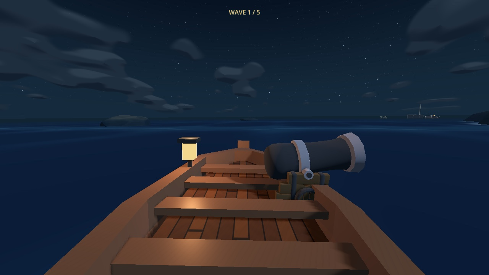
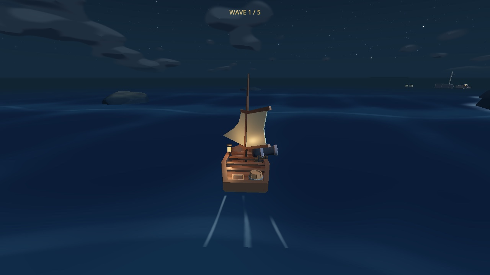
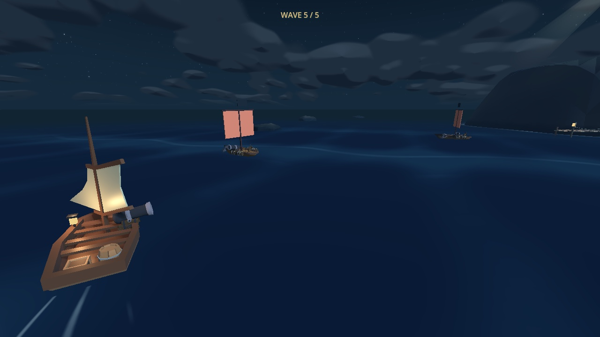

# Restored sailing camera — 18 October 2026

The player can again see the whole sailboat and judge its heading through turns.
Restores the chase framing from `534b021`: 11 m follow distance, 5.5 m height,
5 m look-ahead, 62° base FOV and 7/5.5 per-second position/heading smoothing.
The same Quaternius model regains its visible 35° canvas; no new asset is needed.

Current arena rules, steering, E/F cannon controls, wave forces and analytical
water remain. The existing contact detector still drives spray/audio, and the
deck rig remains an Inspector option. Work stays on `hacking/lighthouse-arena`
without a new PR, as requested. Open draft [PR #6](https://github.com/kickflip-games/ludum_dare_60/pull/6)
by EL-MZ overlaps shared crossing/camera code; its journey changes are not included.

| Requirement | Action and observable result | Evidence |
| --- | --- | --- |
| Whole player and sail are visible | Sail at four headings; entire boat fits with a level horizon | Camera suite: 49.9–50.7% of 720p height; 4:3, 16:9 and 2:1 arena framing pass |
| Steering remains responsive | Held D changes heading; no input keeps automatic sailing on course | Arena input checks pass; turn lag 6.37°, position lag below 1.1 m |
| Preserve interaction and lifecycle | Hold E, press F, release into held A; take fatal damage and press R | Gun transition, real shot, immediate steering and restored spawn/hull/sail pass |
| Preserve water/shore safety and feedback | Cross real crests, then obstruct/release the camera arm | Level horizon, four-crest clearance, real synchronized contact spray and physical shore retraction pass |
| Preserve adjacent gameplay | Run arena, survival, cannon, controls, sighting, ocean and damage regressions | 631 checks across ten suites pass; project import succeeds |

## Native captures

Same arena spawn, heading, viewport and scripted clock for the first sailing
views. Before replays the saved `11a9819` crossing source in the current scene.
Only these initial views are presented as a matched comparison.

| Before | Restored |
| --- | --- |
|  |  |



Also inspected native steering, cannon, release, hull scratches, 4:3/2:1 views,
early clear, countdown, victory and defeat. Survival captures use the existing
protected movement fixture; staged clears/endings do not prove combat success.
Human fun, balance and motion comfort, and Web/mobile performance remain untested.

## Reproduce

Godot 4.8-dev6 (`8898c2b3d`), native Compatibility renderer, Apple M4 Pro.

```sh
godot --headless --path ldjam_60 --fixed-fps 60 --script res://tests/sailing_camera_smoke.gd
# Other passing suites (append _smoke.gd): arena 132, survival 80, cannon_aim 79,
# controls_lifecycle 46, stargazing 123, ocean 40, damage 38,
# turbulence_camera 37 (explicit deck rig), turbulence_effects 13. Camera: 43.
godot --headless --path ldjam_60 --editor --import --quit
godot --path ldjam_60 --fixed-fps 60 --script res://tests/chase_camera_previews.gd -- --output=/tmp/latitude-chase-review
godot --path ldjam_60 --fixed-fps 60 --script res://tests/survival_previews.gd -- --output=/tmp/latitude-chase-survival
```

All ten final suite logs contain zero failures, engine errors or warnings.
Raw captures/logs remain in `/tmp/latitude-chase-camera/`; only three review
images are retained here. The pre-existing splash settings and arena media
are excluded from this change.
