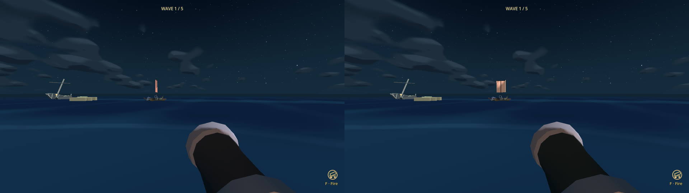
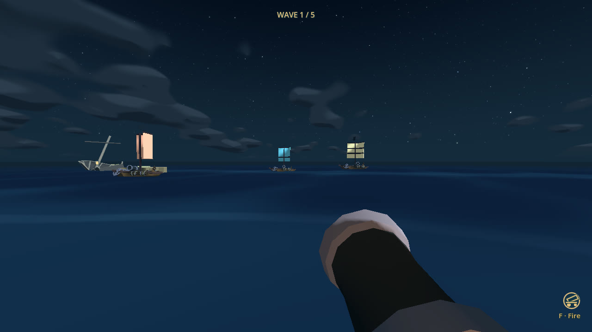
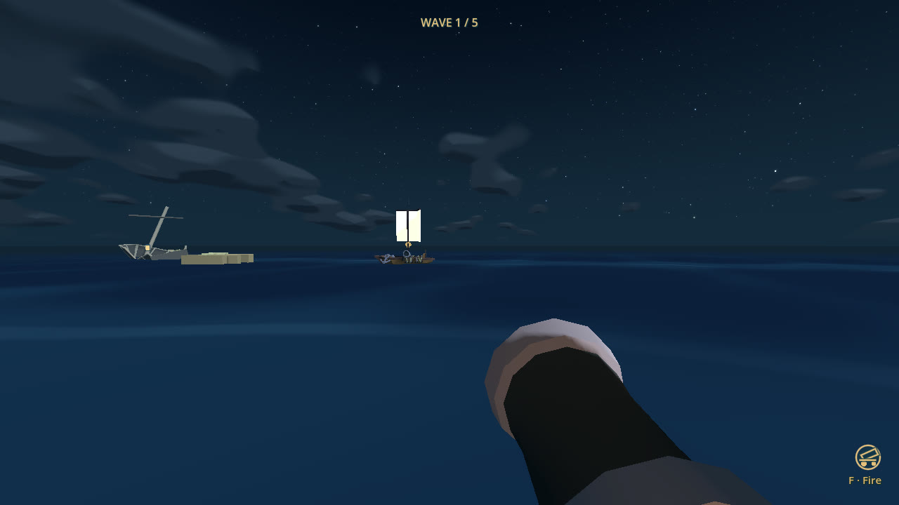
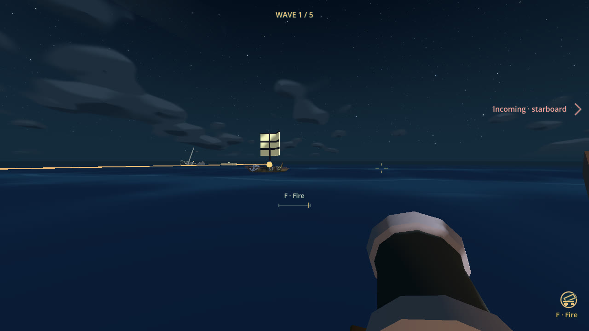
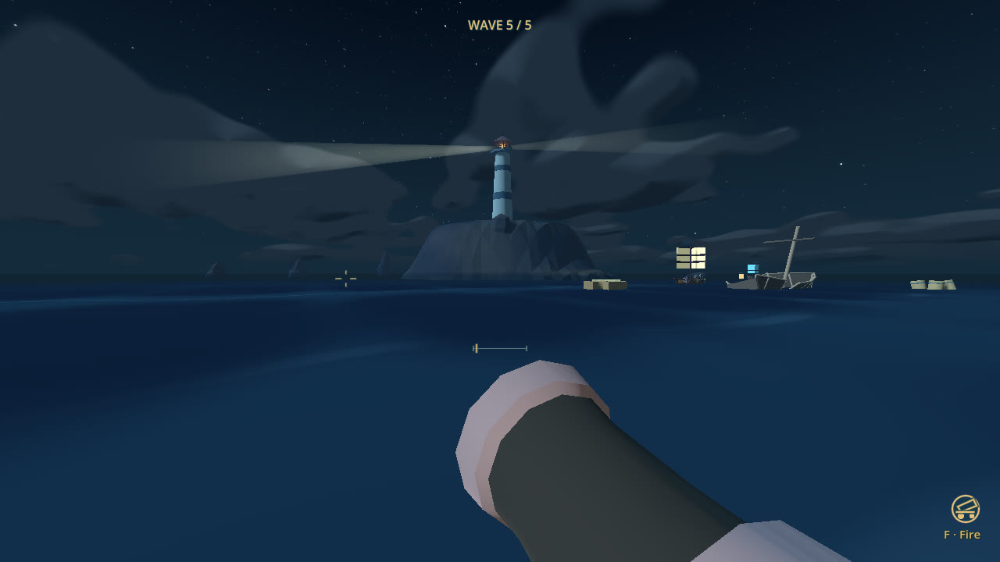
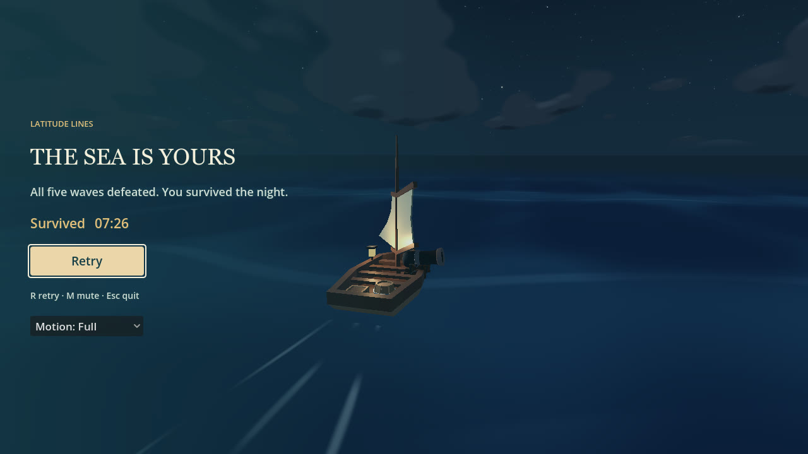

# Naval combat readability and variety — 18 October 2026

Final validation/evidence follow-up on `hacking/combat-feel`.
[PR #10](https://github.com/kickflip-games/ludum_dare_60/pull/10), arena #5 and
timed-survival #8 were merged externally during development, before final evidence
publication. This combat work incorporates main through `84ac328`, preserving
the restored chase camera, visible player sail and configurable **9 m/s** cruise.
The shared checkout was not edited. Separate voyage #6 and water/flow/stronger-wave
#9 by EL-MZ are not included.

## Player experience

- Folded coral, blue-green and ochre sails remain readable at oblique/broadside
  angles. Zero/one/two dark bands and relative size distinguish the three types.
- Holding E softly illuminates valid ships within 90 m and the broadside sector,
  only when a hull/sail sample is in the real camera frustum and unobstructed.
  Releasing E clears it immediately. No markers or floating health bars.
- Accepted hits briefly flash cloth, retain the existing impact sound/splinters,
  and add a small sinking smoke burst. Damage no longer makes sails nearly black.
  A defeated hull tilts and descends for 3.5 seconds before hiding.
- Arena approaches now close on the player instead of perpetually aiming ahead
  of a distant ship. Cached, terrain-clear outer detours work with existing local
  probes. Reciprocal lateral yielding uses each vessel's actual heading.
- Arena rudder response rises from 7/s to 9/s; maximum authority stays 0.72 rad/s.
  Wave forces/profile, pitch/roll limits, rocking muzzle and projectile-water
  sampling stay unchanged. No competing force or flow changes from PR #9.

## Shared profiles and schedule

All types reuse `enemy_ship.tscn` and one AI, configured by
`game/enemy_archetype.gd` and `game/enemies/*.tres`.

| Type | Hits | Speed | Turn / acceleration | Scale | Warning |
| --- | ---: | ---: | --- | ---: | ---: |
| Cutter | 2 | 10 m/s | 0.42 rad/s / 0.65 rad/s² | 1.00 | 1.65 s |
| Skiff | 1 | 12 m/s | 0.60 / 1.00 | 0.82 | 1.80 s |
| Heavy | 3 | 7.8 m/s | 0.30 / 0.40 | 1.18 | 2.30 s |

Speeds account for main's newer 9 m/s player pace. Skiffs use a more oblique
approach and wider, shorter repositioning doglegs, not random jitter. Heavies
use a slower, more direct approach and longer warning. **All attack the player;
there is no lighthouse health or breach/despawn mechanic.**

| Wave | Roster | Next-wave deadline |
| --- | --- | ---: |
| 1 | Cutter | 40 s |
| 2 | Two cutters | 50 s |
| 3 | Cutter + skiff | 65 s |
| 4 | Cutter + skiff + heavy | 80 s |
| 5 | Heavy + two cutters | All resolved |

The five-wave count and 235-second non-early-clear deadline budget are unchanged.
Survivors/queued arrivals carry over, at most three live ships, eight-second
stagger, three-second early-clear pause, capped repair and final shot/sinking
resolution remain. There are **11 ships / 22 required hull hits**. Final cleanup
remains untimed; unchanged deadlines do not establish equal human playthrough length.

## Requirement → evidence

| ID | Requirement / preserved behaviour | Observable evidence |
| --- | --- | --- |
| R1 | Visible ships; aim-only valid illumination | Matched native main/final views; E/no-E, sector, range, hidden, solid occlusion and immediate release checks |
| R2 | Confirmed hit and clear sinking, no redirected shots | Each type takes exactly 2/1/3 real F-fired hits; cloth flash, duplicate-hit rejection, visible descent and cleanup; muzzle vector assertions |
| R3 | Exact data-driven roster; no lighthouse health | All five deployed profile orders verified through the shared pool; 85 scheduler checks include cap, queue, carry-over, repair and final lethal-shot precedence |
| R4 | Bounded, deterministic navigation and spacing | 30 naval checks: blocked island routes at 30/60/120 Hz, no warp/grounding/stall, real locked warnings/shots and three-direction convergence |
| R5 | Countersteerable sea and responsive helm | Skiff survives a real 0.85 m crest disturbance, countersteers with A/D, then sinks to one physical shot; legacy wave/model/cannon regressions and arena return while aiming pass |
| R6 | Full game, no-fire control and lifecycle | Input-only full run: all 11 kills, 22 shots/hits, 3/3 hull; no-input run loses at 67.17 s with zero kills; repeated retry/endings tests pass |
| R7 | Preserve current assets, camera, controls, repair and ocean | Latest-main integration plus adjacent regression suites; no shader/field/terrain/asset replacement, no new controls |

## Actual checks

**862 passing checks across sixteen suites**, with no assertion/script errors:

| Suite | Checks | Suite | Checks |
| --- | ---: | --- | ---: |
| combat_feel | 65 | naval_ai | 30 |
| survival | 85 | arena | 139 |
| cannon_aim | 79 | ship | 34 |
| wave_encounter | 33 | controls_lifecycle | 46 |
| damage | 38 | recovery | 48 |
| hud | 59 | sailing_camera | 43 |
| turbulence_camera | 37 | ocean | 40 |
| archipelago | 65 | combat | 21 |

Controlled moving duels (not human trials):

| Scenario | Duration | Shots / ship hits | Remaining player hull |
| --- | ---: | ---: | ---: |
| Calm cutter | 5.70 s | 2 / 2 | 3 |
| Choppy skiff, five seconds of actual countersteering first | 5.57 s | 1 / 1 | 3 |
| Heavy in open water near the lighthouse | 50.50 s | 3 / 3 | 2 |

The skiff trial measures **1.90 m/s drift** and **0.529 rad/s wave yaw**, not a
calm fixture. Three simultaneous approaches retain **10.61 m minimum root
separation / 3.78 m hull clearance**, no grounding and no stopped interval.
The heavy's naturally locked 2.3-second warning produces a real hit without
evasion and zero hits when steering off the line.

The complete **unprotected input-only** run wins at **446.42 simulated seconds**,
with 11 kills, 22 F-fired shots / 22 physical ship hits, peak three living enemies,
no player damage and no staged kills. The observer knows target positions and
precise firing timing; it never moves enemies, changes health, grants immunity
or redirects a shot. Earlier experimental controllers lost; those failures
informed route/yielding checks, not a claim of human difficulty or win rate.

## Rendered evidence

Godot **4.8-dev6 / 8898c2b3d**, native Compatibility, Apple M4 Pro, 1280×720.
The main/final broadside comparison shares world clock, pose, weather, lens and
viewport. Left is main `84ac328`; right is this combat patch.









[9-second skiff crest/countersteer/shot sequence](combat_feel/skiff-crest.mp4) ·
[8-second heavy warning/fire/no-dodge sequence](combat_feel/heavy-warning.mp4).
Short clips use real moving AI and existing inputs, not protection. The skiff
fixture continues after its kill and later takes a shoreline hit; the heavy
fixture intentionally holds course and receives its warned shot.

The complete native run reproduces the headless result exactly: 446.42 simulated
seconds, 22 physical hits, 11 kills and 3/3 hull. It uses the real renderer with
explicit drawing at saved frames, not continuous rendering for performance
measurement. [Machine-readable result](combat_feel/full-run.json).





The [sinking detail sequence](combat_feel/sinking-sequence.jpg) contains crops at
0, 0.5, 1.5 and 2.5 seconds from native frames, not generated imagery.
Raw frames/logs remain in `/tmp/latitude-combat/` and
`/tmp/latitude-accepted-*_smoke.log`; only compact durable review evidence is committed.

## Reproduce and limits

Use the installed Godot executable in place of `godot`, from repository root:

```sh
godot --headless --path ldjam_60 --fixed-fps 60 --script res://tests/combat_feel_smoke.gd
godot --headless --path ldjam_60 --fixed-fps 60 --script res://tests/naval_ai_smoke.gd
godot --headless --path ldjam_60 --fixed-fps 60 --script res://tests/survival_smoke.gd
godot --headless --path ldjam_60 --fixed-fps 60 --script res://tests/arena_smoke.gd
godot --headless --path ldjam_60 --fixed-fps 60 --script res://tests/combat_arena_playtest.gd
godot --path ldjam_60 --fixed-fps 60 --script res://tests/combat_feel_previews.gd -- --output=/tmp/combat-review
godot --path ldjam_60 --fixed-fps 60 --disable-render-loop --disable-vsync --script res://tests/combat_arena_playtest.gd -- --capture --output=/tmp/combat-full
```

The other twelve smoke commands use the suite names in the table and
`res://tests/<name>_smoke.gd`. Complete legacy physical routes still pass.
Final import and native runs have no script or shutdown-leak warnings. Earlier
offline captures quit before native audio playback resources drained; the fixture
now waits for menu fade, flushes its final frame and lets audio settle before
shutdown. Those superseded warnings were not gameplay assertions.

**Still untested:** human fun/difficulty, broad playthrough timing, audio clarity,
motion comfort, Web/mobile export and performance. Scripted wins and reviewed
frames do not close those gaps. Keep the PR draft.
