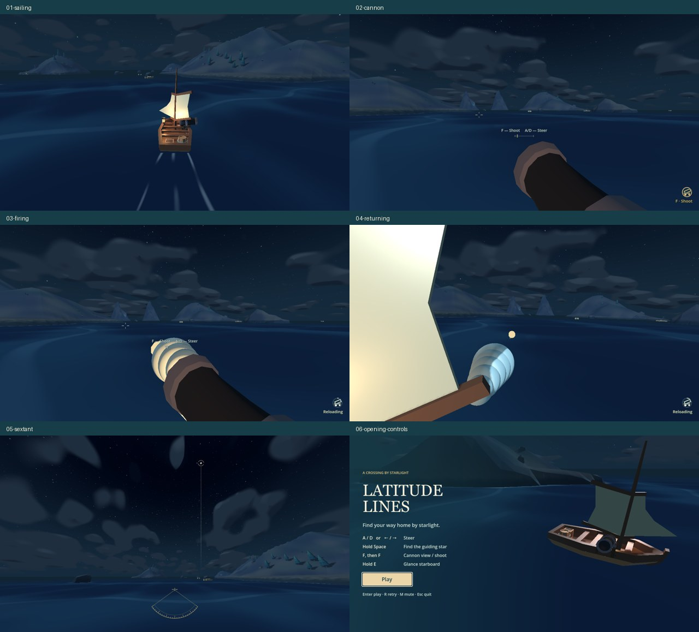
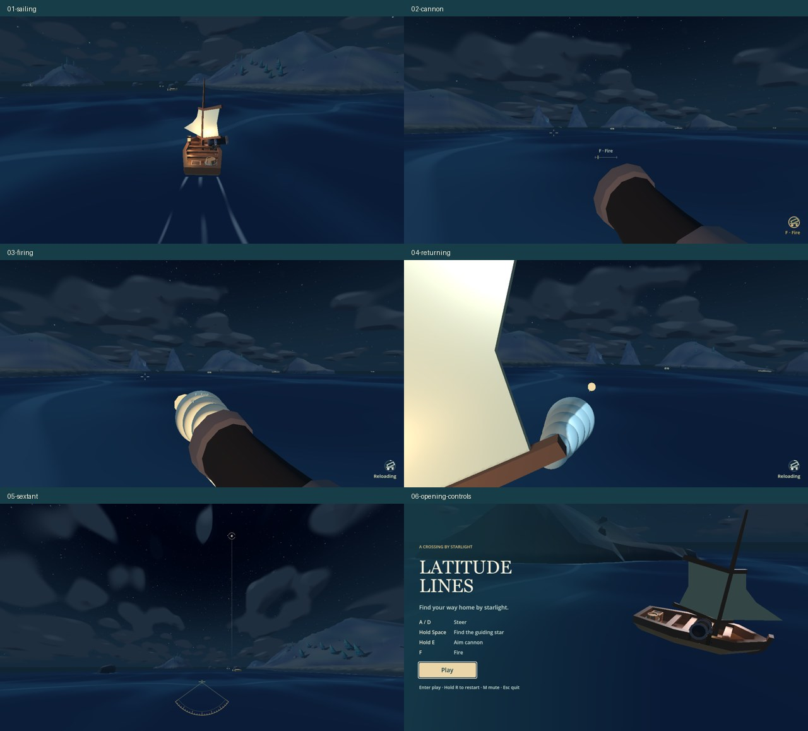

# Latitude Lines controls review — 2026-10-18

- Hold **E** to aim the existing sweeping cannon; release to steer immediately.
- Press **F** once per shot while aiming. Space takes priority; no buffered shots.
- Sextant search/focus is **0.40 + 0.40 seconds**. Each new hold searches afresh.
- During sailing, hold **R for 0.6 seconds**; release early to cancel. End screens accept an immediate press.

## Contract and scope

Player experience: learn one hold/release aiming action, fire with a fresh press,
find the guiding star sooner, and avoid accidental voyage restarts.

Baseline: `crossing.gd` handled input/camera/sighting/retry; `broadside_cannon.gd`
used F for entry and firing plus steering to exit. The same gun, camera, sweep,
projectiles and existing gameplay suites remain in use. Baseline captures were
rerun from an isolated `4f464ec` source snapshot with native HUD redraws enabled.

Fixed: automatic forward movement, A/D and arrow steering, wave and momentum
models, damage/repairs, enemy AI, ballistics, visible muzzle authority, 1.5-second
reload, ±30°/three-second sweep, navigation targets and sextant design. Only input
ownership, focus defaults, temporary hints and their fixtures/instructions changed.
No steering visual retuning was needed after camera, heel and curved-wake review.

## Acceptance evidence

| ID | Requirement / invariant | Trigger and expected observation | Actual evidence |
| --- | --- | --- | --- |
| R1 | A/D steer normally; E suspends manual steering | Hold A or D during E, then release E: aiming persists until release; heading responds on the first return tick | Cannon suite: both directions, residual camera blend and nearby hostile; passed |
| R2 | Hold E aims, release returns; no double F entry | Hold/release/repress E: camera enters/returns, sweep restarts at centre; repeated short holds settle | Cannon suite + seven native captures/280-frame sequence; passed |
| R3 | F fires only while aiming; no autofire/buffering | F alone, F before E, reload taps, held F through reload, E release, same-frame E+F both orders | Cannon suite: real projectiles, one shot, no delayed repeats; passed |
| R4 | Space has priority; steering remains available | All six E/F/Space orders suppress gun/fire; A/D still changes heading; Space release resumes held E without old F | Lifecycle + stargazing suites; passed |
| R5 | Focus loss, retry, sinking and victory clear controls | Lose focus or finish while E/F/R are held and a shot is pending: no stuck gun, shot or incomplete restart survives | Lifecycle, cannon, navigation, HUD, damage suites; passed |
| R6 | Sextant fully focuses at about 0.8 s; no ordinary-view guidance | Space at 0.3/0.6/0.8 s: search/partial/full focus; release removes halo, line and instrument; new hold starts fresh | Stargazing timing/projection checks + native full-focus frame at 0.8 s; passed |
| R7 | R needs a continuous 0.6 s during sailing; only once per hold | Tap/partial release/sub-tick release cancels; full hold retries once; end-screen fresh R retries immediately | Lifecycle suite at 30/60/120 Hz, title/cast-off and focus-loss checks; passed |
| R8 | Minimal HUD and current instructions | Opening menu shows A/D, Hold Space, Hold E, F; ordinary sailing has no navigation overlay; only held R shows restart hint | HUD suite, updated tooltips/docs and before/after capture review; passed |
| R9 | Existing gameplay remains functional | Real barrel-directed shots hit moving ships; waves/rocks still disturb/damage during E; repairs and complete voyages still work | Three duels, ship/combat/recovery/wave/camera/crossing suites; passed |
| R10 | Updated tests pass | Run touched input, UI and gameplay suites | 17 suites passed (1,033 successful assertions/trial results). Separate inherited night-ocean failure below |

## Before / after

Actual Godot 4.8-dev6 Compatibility renderer, Apple M4 Pro, 1280×720.
Same departure, heading, weather and input timeline; gun entry uses old F before
and held E after. Full-focus capture waits 1.8 seconds before, 0.8 seconds after.
Sheets include normal sailing, gun view, firing, return, sextant and opening menu.





- Reviewed full-resolution cannon and focused-star frames plus sampled transition frames.
- The normal view stays clear; the existing barrel, flash, reload ring, halo,
  sextant arc and horizon line remain readable.
- Camera entry/return follows actual `InputEventAction` sequences; A/D resumes
  during return. The sail briefly crosses the camera, as in the baseline.
- Raw PNGs, 20 fps frame sequences and `after.mp4` remain local under
  `/tmp/latitude-controls/`; only these compact sheets are retained for web review.
- This is scripted in-engine validation and rendered inspection. Human keyboard
  playtesting, learnability, fun, fairness and combat balance were **not tested**.
  Sound playback was not subjectively reviewed; the shot/audio path was preserved.

## Commands and results

Installed executable used:

```sh
GODOT_BIN='/Users/avi/Library/Application Support/Godot/app_userdata/Godots/versions/Godot_v4_8-dev6_macos_universal/Godot.app/Contents/MacOS/Godot'
"$GODOT_BIN" --headless --path ldjam_60 --fixed-fps 60 --script res://tests/cannon_aim_smoke.gd
```

The same headless invocation was run for each script below. Most runs also used
`--log-file /tmp/latitude-<script>-engine.log`; console logs are under `/tmp/latitude-<script>.log`
(cannon console log: `/tmp/latitude-cannon-check.log`).

| Script in `ldjam_60/tests/` | Result |
| --- | --- |
| `cannon_aim_smoke.gd` | 79 checks, 0 failures |
| `controls_lifecycle_smoke.gd` | 46 checks, 0 failures |
| `cannon_aim_battles.gd` | 3/3 duels; 2 hits each, player survived; one warned release-E dodge each |
| `stargazing_smoke.gd` | 123 checks, 0 failures |
| `navigation_smoke.gd` | 285 checks, 0 failures |
| `hud_smoke.gd` | 59 checks, 0 failures |
| `crossing_smoke.gd` | 65 checks, 0 failures; both physical routes complete in 225.57 / 269.23 simulated seconds |
| `wave_encounter_smoke.gd` | 33 checks, 0 failures |
| `dynamic_wave_smoke.gd` | 18 checks, 0 failures |
| `combat_smoke.gd` | 21 PASS assertions, exit 0 |
| `recovery_smoke.gd` | 48 checks, 0 failures |
| `damage_smoke.gd` | 38 checks, 0 failures |
| `ship_smoke.gd` | 34 checks, 0 failures |
| `ocean_smoke.gd` | 40 PASS assertions, exit 0 |
| `sailing_camera_smoke.gd` | 28 checks, 0 failures |
| `ui_review_smoke.gd` | 89 checks, 0 failures |
| `atmosphere_smoke.gd` | 24 checks, 0 failures |
| `night_ocean_smoke.gd` | 21 pass, 1 inherited failure; also reproduced on unchanged baseline |

```sh
"$GODOT_BIN" --path ldjam_60 --fixed-fps 60 --script res://tests/controls_previews.gd -- --output=/tmp/latitude-controls/after
"$GODOT_BIN" --headless --log-file /tmp/latitude-controls-import.log --editor --path ldjam_60 --import --quit

git diff --check
```

Native capture: seven PNGs, 280 rendered frames, zero failed capture-state checks.
Project import completed successfully. Whitespace check passed.
Sandboxed headless runs emitted a macOS system-CA lookup warning; initial runs
also could not write the default user log. Explicit `/tmp` log paths were used
for later runs. No GDScript parse/runtime errors occurred in the final tests.

## Existing limitation

`night_ocean_smoke.gd` rejects the coastal-foam mask's stored terrain/layout hash.
The same assertion fails on the unchanged baseline; its other 21 checks pass in
both versions. This patch does not change the mesh, map, foam bake or ocean logic.
The failure is retained and reported, rather than rebaking unrelated assets.

## Files changed

- Gameplay: `ldjam_60/game/{crossing,broadside_cannon,navigation_hud,nautical_gauge}.gd`.
- Instructions: `README.md`, `AGENTS.md`, `changelog.md`,
  `ldjam_60/game/{ocean,world}/README.md`.
- Core tests/pilot: `cannon_aim_smoke.gd`, `cannon_aim_battles.gd`,
  `cannon_sweep_pilot.gd`, `stargazing_smoke.gd`, `navigation_smoke.gd`,
  `hud_smoke.gd`, `archipelago_smoke.gd`, `atmosphere_smoke.gd`,
  `combat_smoke.gd`, `ocean_smoke.gd`, `ship_smoke.gd`.
- New tests/tooling: `controls_lifecycle_smoke.gd`, `controls_previews.gd`
  and their Godot UID sidecars.
- Capture/review fixtures: `cannon_aim_previews.gd`, `atmosphere_previews.gd`,
  `dynamic_water_previews.gd`, `night_cloud_previews.gd`, `night_ocean_previews.gd`,
  `ocean_render_check.gd`, `sailing_camera_previews.gd`, `ui_review_states.gd`.
  Test paths above are relative to `ldjam_60/tests/`.
- The concurrent `ae1be4f` implementation commit also includes Godot import
  metadata for the existing Kickflip logo; its source and presentation were not
  changed by this controls task.
- Review evidence: this report and `artifacts/controls_review/{before,after}.jpg`.
