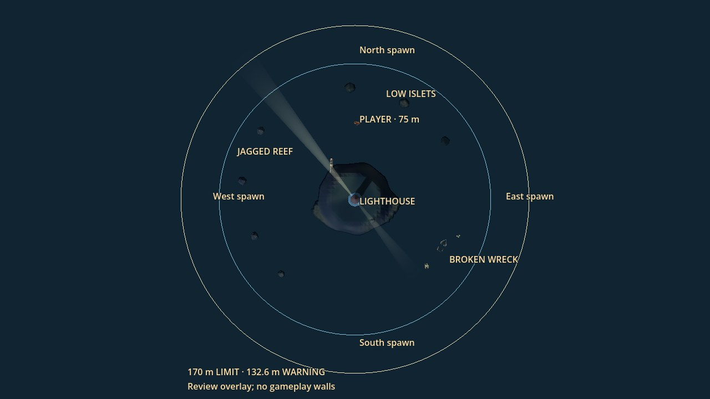
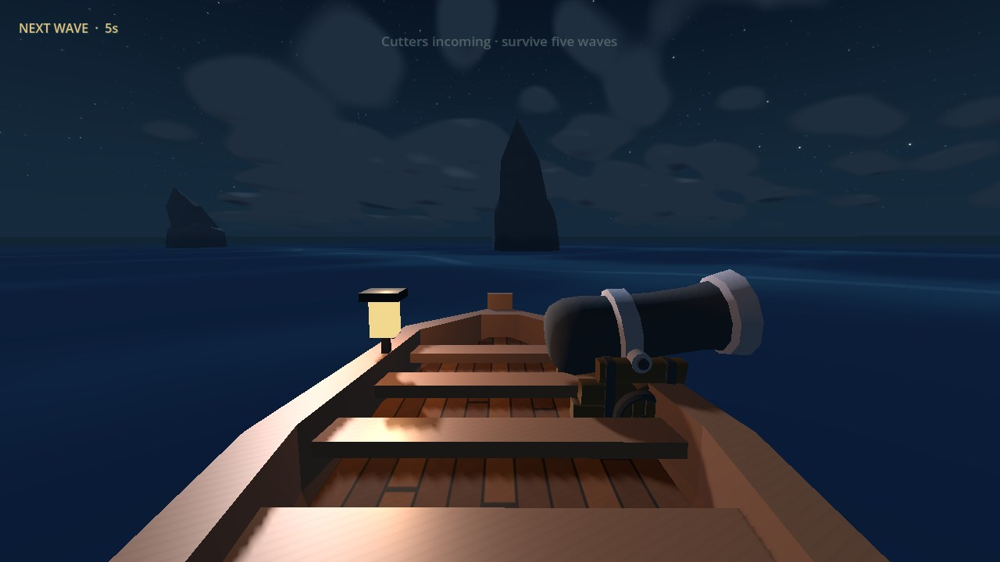
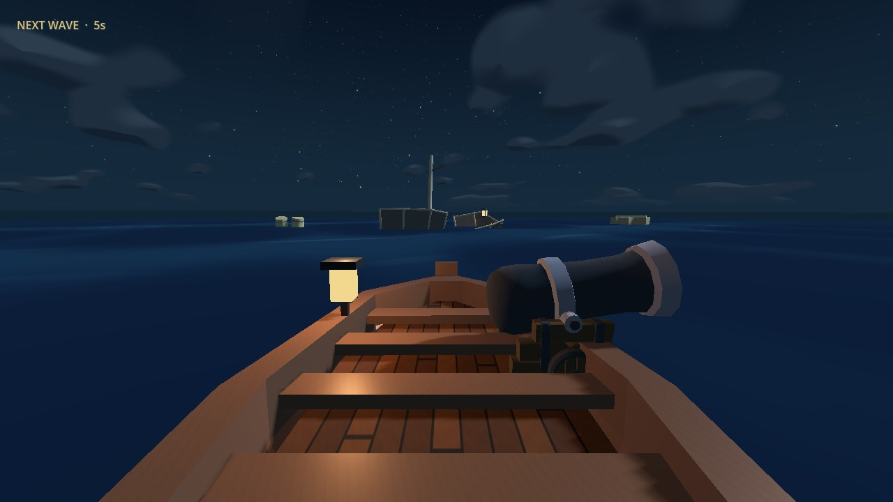
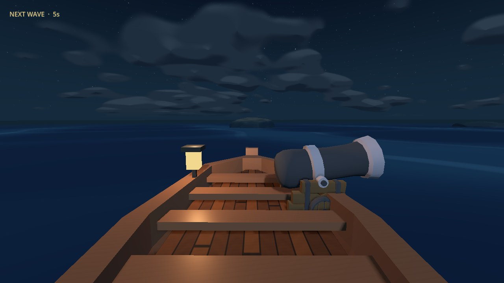
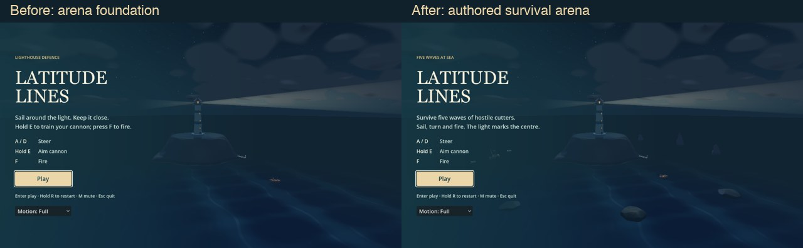
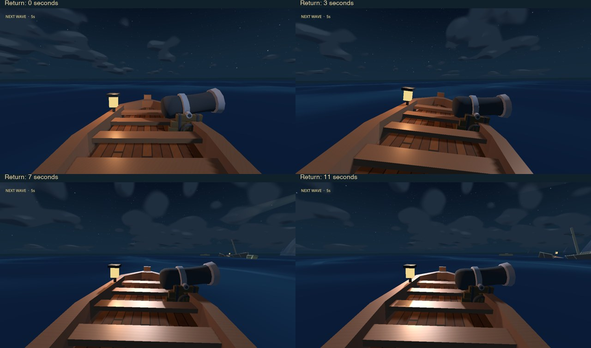

# Lighthouse survival arena — 18 October 2026

Existing draft [PR #5](https://github.com/kickflip-games/ludum_dare_60/pull/5),
branch `hacking/lighthouse-arena`. The revised specification is implemented on
top of the unfinished arena foundation. PR #6 by EL-MZ contains a conflicting
voyage-navigation proposal and was left untouched. The local splash settings in
`project.godot` remain outside this change.

## Player experience

- Sail and fight around the existing lit lighthouse in a 170 m arena. Start
  75 m north, heading 100°, with clear water ahead and around the hull.
- Four tall, irregular reef teeth curve around the west; a split, half-sunken
  wreck and destructible cargo sit southeast; three low islets lie north/east.
  Keep the broad outer ring and alternative inner routes available.
- Survive five waves, each reusing one existing cutter. Enemies target the player.
  The lighthouse has no health or damage; there are no new weapons or enemy types.
- Sink each cutter, finish its sinking animation and resolve its incoming shots
  before the ten-second recovery interval. The fifth cleared wave wins.
  Time passing and old harbour entry never award victory.
- A/D steering, automatic forward motion, held E/fresh F cannon, damage, repair,
  held R/retry and night sea presentation retain their existing contracts.

## Implementation and evidence

| ID | Requirement | Changed implementation | Observable evidence |
| --- | --- | --- | --- |
| R1 | Compact, readable layout and safe start | `archipelago.tscn`, separate `arena_*.res` terrain/foam, `arena_layout.tscn`; distant voyage terrain/dressing excluded | 75 m spawn/heading/depth checks; 75 m collision-free departure; native menu/spawn/overhead |
| R2 | Editable obstacles, two routes each, broad passages | Three marker groups in `arena_layout.tscn`; existing rock, stone material, hull-section and floating-prop geometry reused | Six held-A/D routes, full circumnavigation, five >=30 m passage sweeps; no contact in measured routes |
| R3 | Honest obstacle collision | `archipelago.gd` bakes visible faces in metres, including imported transforms; two-sided thin wreck faces; no proxy spheres | Player hull is blocked/damaged by a reef; real projectile segments hit authored surfaces; solid pieces persist, both sides shatter timber/barrels; no-shot control and retry |
| R4 | Smooth return with control and momentum | `arena_return.gd`, `crossing.gd`; 132.6 m warning, blended rudder, 32 m hull-width obstacle probes; bounded motion before physical sweep | Eight outward bearings at 30/60/120 Hz; continuous heading/position, no rock damage; outward-seeking control; held E/A cannot escape, F fires, E release restores steering |
| R5 | Wave and hard-limit safety | Existing wave field/shader/sailing authority retained; arena-only long-frame substeps and outward drift removal | Four maximum-height crests plus drift/outward helm at 30/60/120 Hz; tangent-motion check and two-second stalled frame |
| R6 | Safe enemy entry/navigation | Four cardinal 143 m sector markers with 16° spread; 65 m player separation, 12 m clearance/depth checks; arena hull-width feelers and bounded travel | All four sectors; blocked-sector deferral; six 30-second cutter approaches with zero grounded frames or prolonged stops |
| R7 | Five player-targeted waves | `enemy_encounters.gd`, `enemy_ship.gd`, `navigation_hud.gd`; no arena timeout retreat | 90-second no-fire control cannot clear wave; actual E/F ballistic hit damages cutter; five-wave state/ending checks |
| R8 | Lifecycle and old objectives | `crossing.gd`, `voyage_director.gd`, landmark-light cleanup | Old harbour cannot win; hull repair, sinking and keyboard R retry restore the same spawn, obstacles and clean transient state |

Implementation freedom was limited to marker positions, silhouettes, spawn
sectors/delays and return tuning. The wave sampler, sailing integrator, weapon,
existing cutter type and licensed art remain the shared baseline. Inner sailing
has no obstacle autopilot; deliberately steering into the lighthouse/rocks still
uses ordinary collision rules.

## Validation

- **671 checks passed:** arena 143; twelve adjacent suites 528. Every suite
  exited successfully with no failed assertions or script errors.
- Arena cases include six input-driven obstacle routes and a full circuit,
  24 no-input returns lasting 28 seconds each at 30/60/120 Hz, held aiming,
  maximum crests/drift/outward helm, visible-face projectile impacts, a real E/F
  cutter hit, five-wave lifecycle, blocked spawns and keyboard retry.
- Six cutter approaches ran for 30 simulated seconds each: zero grounded frames,
  no prolonged stop; measured maximum radius was 146.65 m. These are
  controlled navigation scenarios, not a broad combat-balance guarantee.
- Final Godot editor import completed; native launch/captures and whitespace
  checks passed. No script errors or leak warnings in the final native capture.
  Sandboxed headless runs print a macOS certificate-store warning from the
  installed runtime; it did not prevent the tests/import from completing.
- Initial checks caught faulty collision scaling and a recovery-contact damage
  omission. Both were repaired before the final passing run. Earlier shared
  timing/AI changes were scoped to arena mode after voyage regressions caught
  their effect; both affected suites then passed unchanged assertions.

Commands use the installed Godot 4.8-dev6 (`8898c2b3d`):

```sh
godot --headless --path ldjam_60 --fixed-fps 60 --script res://tests/arena_smoke.gd
godot --headless --path ldjam_60 --fixed-fps 60 --script res://tests/<suite>_smoke.gd
godot --path ldjam_60 --fixed-fps 60 --script res://tests/arena_previews.gd -- --output=/tmp/latitude-arena-revision/after
```

The twelve adjacent suites are cannon_aim, combat, recovery, controls_lifecycle,
wave_encounter, damage, sailing_camera, hud, archipelago, ship, turbulence_camera
and ocean. They explicitly use `tests/legacy_voyage.tscn` to retain the historical
journey assertions. The arena suite exercises normal `crossing.tscn` and cannot
be replaced by those regression passes.

The five-wave lifecycle check applies real cannon impact handling to defeat
successive cutters; a separate E/F test launches a real ballistic hit. This is
not an input-driven human playthrough of all five fights. Navigation tests keep
the player at controlled locations; human combat difficulty/fairness and broader
moving-player coverage remain open. Browser/mobile performance was not measured.

Raw logs, measurements and captures remain in `/tmp/latitude-arena-revision/`.
Only small images required for durable web review are committed here. The early
foundation media with older names in the local review directory is superseded
by the images below and is not evidence for this revised layout.

## Rendered review

Native Compatibility renderer, Apple M4 Pro, 1280×720. All final frames and the
12-second return sequence were inspected. Helm views share a 74° lens and fixed
sea clock. The overhead alone disables distance fog and adds labelled rings;
these annotations are absent from gameplay and do not represent physical walls.



| Reef at the helm | Wreck at the helm | Islets at the helm |
| --- | --- | --- |
|  |  |  |





[Safe spawn](lighthouse_arena/safe-spawn.jpg) · [First wave](lighthouse_arena/first-wave.jpg)
