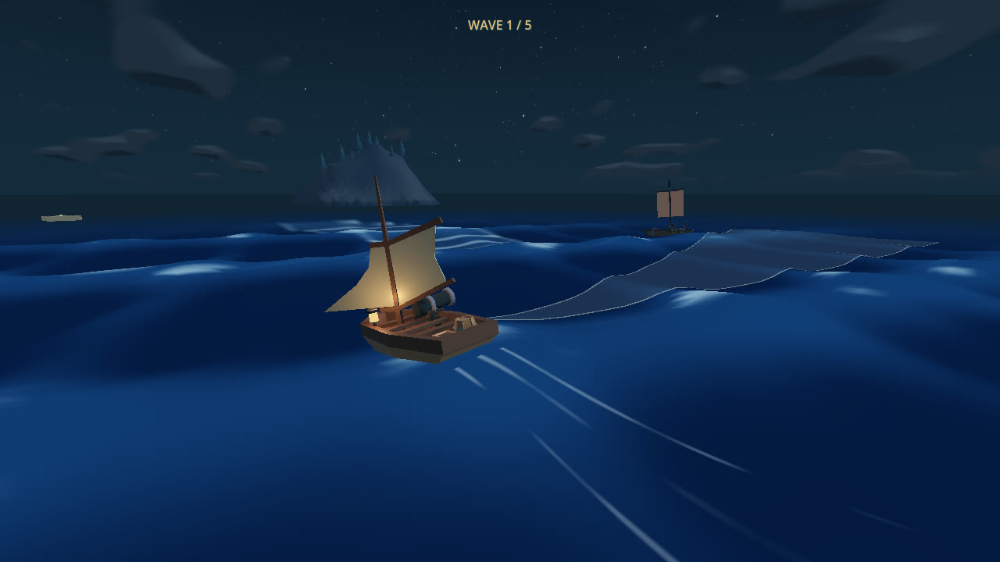
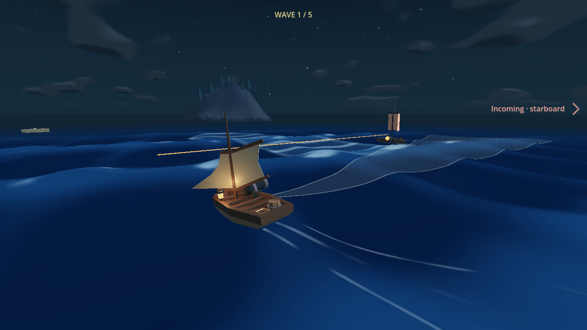
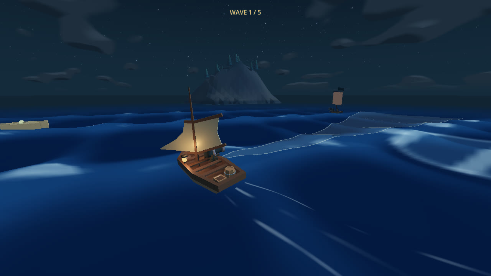
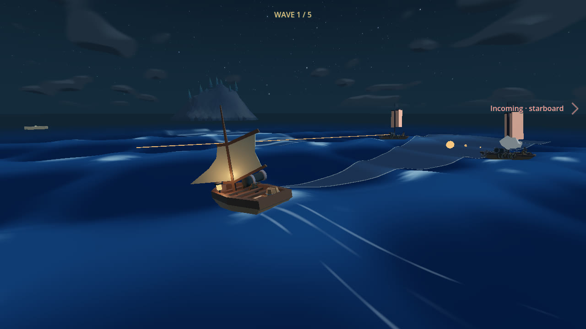
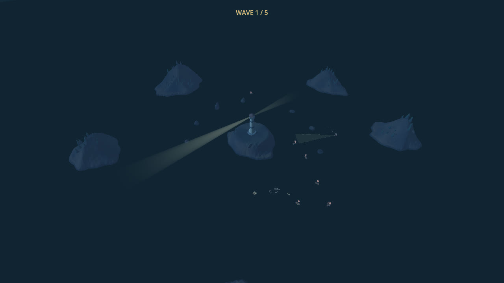

# Naval attack runs and fleet coordination

## Outcome and scope

Ships commit to an interception, sail a predictable parallel pass, turn away and
rejoin a fair queue. Navigation and weapons have independent clocks. The director
allocates slots and warning times, not rudder inputs. Waiting ships remain moving,
visible and vulnerable. All enemies target the player, never lighthouse health.

The established 2/3/4/5/6 roster (20 enemies), existing cutter/skiff/heavy resources,
timed carryover, early-clear repairs, current cannon cone, controls, chase camera,
water, flow rewards and Shift boost are preserved. No new enemy class or HUD was
introduced. This PR also retains the final combat evidence consolidated from #11.

## Causes addressed

- The historical 24-second disappearance had already been removed from arena
  play before this task. Arena retreat is now explicitly rejected; living ships
  remain in the wave until destroyed. The retained voyage still has visible
  retreat and distance/offscreen cleanup.
- The combined movement/weapon state machine and repeatedly moving approach
  targets interrupted predictable passes. Navigation now commits to a snapshot;
  a separate weapon machine preserves sailing during warning, fire and reload.
- Steering corrections competed, and repeated contact replaced the escape
  heading every tick. One prioritized steering decision and a latched, bounded
  five-second recovery prevent prolonged grounding without teleporting.
- A waypoint could be treated as passed before reaching its lane, or be
  reacquired after joining. Lane entry is now latched; the 40-second bounded
  approach budget accommodates a cross-island detour before releasing its slot.
- Single-ship assumptions are replaced by six pooled hulls, unique defeat
  accounting, fair slot ownership and a stable, validity-checked camera focus.

## Main tuning

| Setting | Current value |
| --- | --- |
| Attack slots by wave | 1 / 1 / 2 / 2 / 2 |
| Warning-start separation | 1.6 s |
| Desired broadside separation | 25–45 m, cutter 34 m |
| Pass / turn-away | Profile pass (cutter 7 s) / 4 s |
| Maximum approach | 40 s; missed interceptions release their slot |
| Turn authority | Existing profiles; cutter 0.65 rad/s, 0.95 rad/s² |
| Transit / pass speed | Existing profiles; passes match approximately unboosted player speed |
| Holding radii / speed | 112 / 130 / 145 m; 6.2–6.9 m/s |
| Player / ship separation | 19 / 16 m preferred |
| Avoidance commitment / contact recovery | 1.5 / 5 s |
| Arena safety | Lighthouse centre; outer motion limited to 165 m |

Tune ship behavior in `game/enemy_ship.gd` and existing archetype resources;
slot/warning tuning is in `game/survival_settings.gd`. Strong player turns or
boosting can intentionally spoil a committed pass.

## Requirement-to-evidence map

Stage 1 was implemented and validated before the director was added: 62
single-ship checks and native approach/pass/turn inspection at commit `741f919`.
Final integration rechecks the current main, including its subsequently merged
water, boost, cone and damage-camera changes.

| Requirement | Observable check / evidence |
| --- | --- |
| Independent navigation and guns | `attack_run_smoke.gd`: committed approach, uninterrupted warning/reload travel, pass → turn → reposition |
| Useful straight passes, second approach, bounded steering | `ship_smoke.gd`: two passes, 6.57 s useful window, 30/60 Hz turn/acceleration limits and unchanged-course incoming hits |
| Non-homing shots and meaningful dodge | Single-ship suites compare fixed warning points/shot velocities and real hit versus warned steering |
| Two-hit cutter and every target | `fleet_interactions_smoke.gd`: ordinary fire inputs sink each of six moving holding hulls; owner defeat releases and transfers its slot |
| No silent despawn / safe recovery | 90-second cross-island routes plus 180-second fleet trials; visible, collidable living ships, bounded movement and terrain/circle checks |
| Fair slots / holding / separation | `fleet_smoke.gd`: 1/2/4/6 ships at 60 Hz and six at 30 Hz, positions/headings/states recorded every 0.5 s, every ship receives a slot |
| Staggered shots / stable camera | Two staged simultaneous passes fire real shots; warning starts at 1.0167 and 2.6333 s; focus stays stable and rejects sunk targets |
| Wave counts / duplicate death / carryover / retry | `survival_smoke.gd` plus real holding/owner kills; exact counts, queued arrivals, final projectile gating, loss/victory and repeated clean retry |
| Actual full battle | `combat_arena_playtest.gd`: normal steering/fire only, production terrain/waves/health/rosters; no enemy relocation, direct damage or immunity |
| Preserved controls/camera/boost | Arcade controls, cone, damage camera, legacy combat and night boost suites |
| Real rendering and motion | Approach/pass/turn, alternating pair and six-ship sequences below; contact sheets inspected, not merely generated |

Scheduler unit tests intentionally isolate counts/transitions; they are not
presented as input-driven kills. Real projectile tests and the full pilot provide
that evidence separately. Legacy static cannon fixtures disable swell to test
their geometric assertions; the full arena battle retains production waves.

### Final regression results

All **486 checks pass** across these eleven suites:

| Suite | Passing checks |
| --- | ---: |
| ship_smoke | 34 |
| attack_run_smoke | 28 |
| fleet_smoke | 50 |
| fleet_interactions_smoke | 34 |
| survival_smoke | 86 |
| arcade_controls_smoke | 74 |
| starboard_cone_smoke | 33 |
| damage_camera_smoke | 51 |
| combat_smoke | 21 |
| enemy_pressure_smoke | 27 |
| night_boost_wave_smoke | 48 |

Import and script parsing succeeded; no script errors occur in these final logs.
`git diff --check` passes. The final controls include main's E camera toggle and
±10-degree cannon cone; they are not reverted to the earlier wider cone.

In the six-ship 180-second trials, every ship gets a slot and remains alive
without player fire. At 60/30 Hz: peak owners 2/2, longest stop 0.35/0.40 s,
contact episodes 1/30, minimum solver clearance −0.020/−0.075 m and maximum
radius 155.73/155.51 m. Rudder rate stays at or below 0.65 rad/s.
[Summary measurements](naval_ai/fleet-metrics.json) and
[complete sampled positions/headings/states](naval_ai/fleet-trace.json.gz)
retain the observed values, including sparse attack opportunities in the
continuous-turning control rather than hiding them.

The final [normal-input battle](naval_ai/full-battle.json) wins at **283.12 s**:
20 defeats, 36 physical hull hits from 49 shots, all five waves, 3/3 hull.
The production wave-yaw cap reaches 0.56 rad/s during this run; waves are active.
No direct damage, enemy repositioning or player immunity is used.

## Reproduce

Installed engine: Godot 4.8-dev6 (`8898c2b3d`). From the repository root:

```sh
"$GODOT_BIN" --headless --path ldjam_60 --fixed-fps 60 --script res://tests/attack_run_smoke.gd
"$GODOT_BIN" --headless --path ldjam_60 --fixed-fps 60 --script res://tests/fleet_smoke.gd
"$GODOT_BIN" --headless --path ldjam_60 --fixed-fps 60 --script res://tests/fleet_interactions_smoke.gd
"$GODOT_BIN" --headless --path ldjam_60 --fixed-fps 60 --script res://tests/combat_arena_playtest.gd -- --output=/tmp/latitude-naval/release-play
"$GODOT_BIN" --path ldjam_60 --rendering-method gl_compatibility --fixed-fps 60 --disable-vsync --disable-render-loop --script res://tests/attack_run_previews.gd
"$GODOT_BIN" --path ldjam_60 --rendering-method gl_compatibility --fixed-fps 60 --disable-vsync --disable-render-loop --script res://tests/fleet_previews.gd
```

The fleet's temporary full traces are `/tmp/latitude-fleet.json`; published
summary measurements and full-battle results accompany this report.

## Rendered evidence







[22-second attack sequence](naval_ai/attack-run.mp4) ·
[30-second fleet overview](naval_ai/six-ships.mp4).
The overview uses a test-only elevated camera; normal gameplay camera is unchanged.
The pair fixture stages two attack lanes to isolate warning coordination.

## Limitations and next tuning

- Human fun, fairness, comfort and audio balance are **not** established by an
  automated pilot. Browser/mobile performance was not reprofiled for this AI.
- Ships can brush one another. Stress checks allow at most 10 cm solver overlap,
  bounded contact counts and no sustained pileup; this is not a zero-contact claim.
- Constant course changes, the automatic arena return, terrain and boosting can
  spoil multiple approaches. The historical “four shots in 90 seconds” chase
  pressure assertion is intentionally superseded by slot-limited committed runs;
  actual pressure measurements remain logged. Tune approach timing and holding
  radii after human playtesting rather than restoring perfect pursuit.
  In the unsteered perimeter-return observation, all shots can be spoiled for
  90 seconds; this remains a pressure/balance limitation, not a guaranteed attack
  frequency. The straight-course hit/dodge fixtures independently verify threat.
- A separate native full-pilot attempt before the final cone narrowing
  [lost in wave five](naval_ai/native-loss.json) after 11 kills, from
  barrel/ship/rock contacts. The loss screen was captured and inspected. It is not
  reported as a rendered victory or substituted for the successful headless run.
- Rendered enemies are recognizable and runs remain readable, but wide overview
  ships are small and distant terrain can temporarily obscure them.

## Files

Gameplay: `enemy_ship.gd`, new `enemy_director.gd`,
`enemy_encounters.gd`, `survival_settings.gd`.
Regression/evidence: new attack-run and fleet suites/previews; updated survival,
naval/ship/combat/pressure fixtures and the input-only arena pilot.
Documentation: README, changelog, this report and durable review captures.
