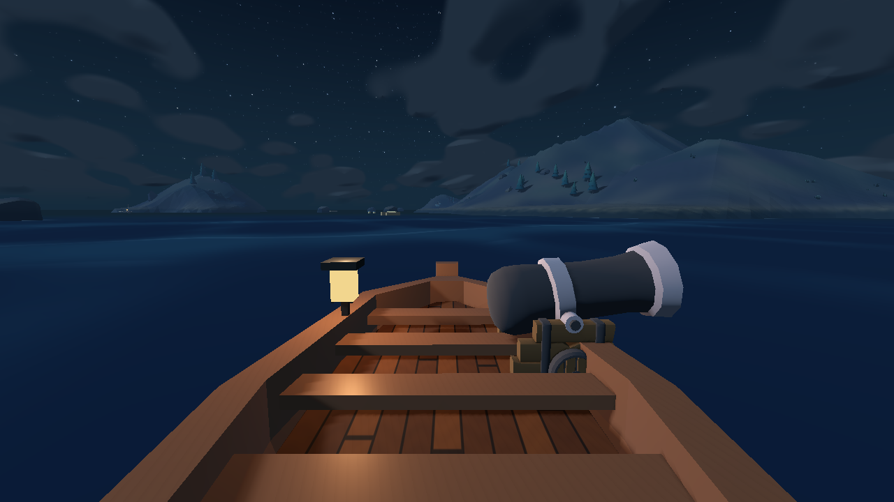
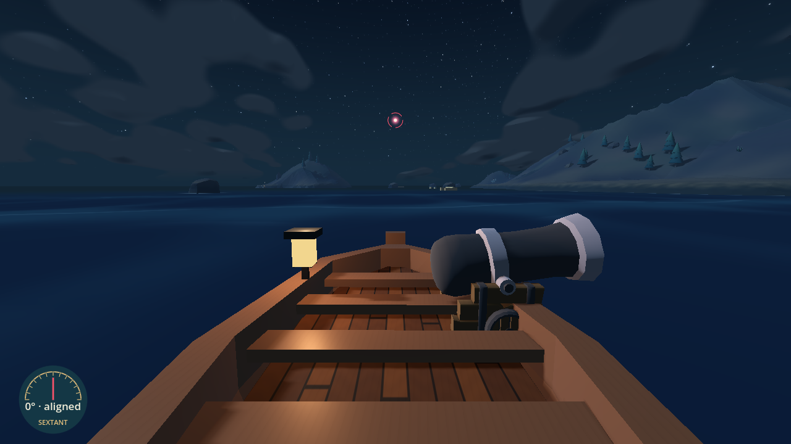
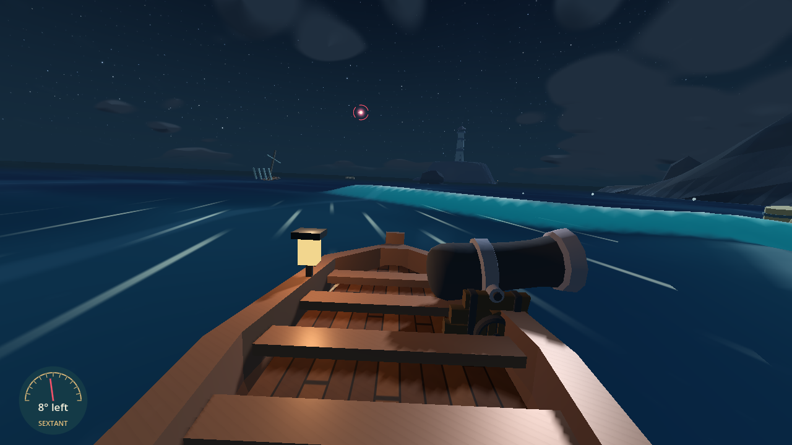
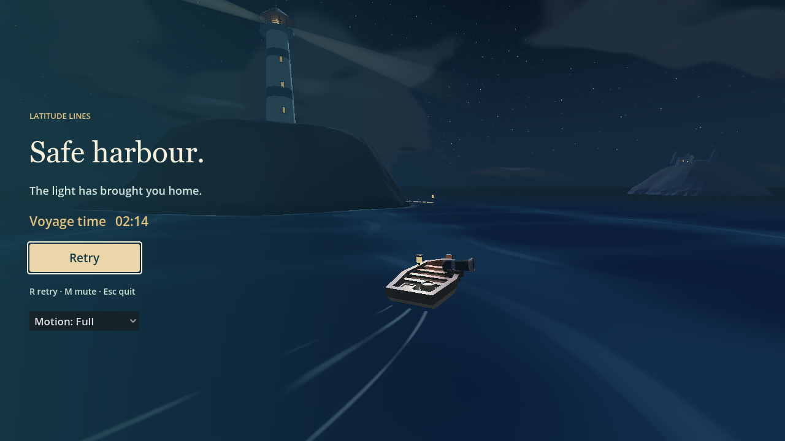

# Star-guided lighthouse journey

18 October 2026. Implemented on `codex/navigation-redesign-plan`, draft
[PR #6](https://github.com/kickflip-games/ludum_dare_60/pull/6).

## Player experience and scope

The permanent lower-left sextant reads the signed horizontal angle from the bow
to one bright red/blue star at 12 degrees elevation. Space no longer activates
guidance or changes the camera. Eleven ordered short passages lead through clear
water past the Wreck and Twin Peaks waters into the actual lighthouse harbour.
Each handoff changes color/halo and gives a chime and short notice.

Cruise is 9.5 m/s; three visible pale-gold wind lanes ease toward 12.5 m/s and
back to cruise after exit. Cutter transit speed is 10.5 m/s so its approach and
return still work with the faster player; warning, firing, rudder, damage and
retreat rules remain intact. No automatic steering or waypoint arrow was added.

Each new star aligned within 8 degrees for 0.35 seconds summons one fixed
turbulence region centred 45 m ahead, with a 40 m presentation radius. Its
duration is calculated as **70% of the nominal 15-second star-leg budget:
10.5 seconds**. Actual physical leg times vary; a missed destination remains
active, and this does not prolong or repeat its turbulence. All generated crests
finish inside the zone endpoint. Short legs can overlap zone lifetimes while
the shared field remains capped at four waves. Win/loss/retry clear live zones.

This is the lighthouse journey work. The separate arena direction remains in
[PR #5](https://github.com/kickflip-games/ludum_dare_60/pull/5), by avivajpeyi.
Shared crossing/camera/movement files need coordination when integrating those
branches; no arena implementation was taken over.

## Requirement-to-evidence contract

| ID | Requirement / preserved behavior | Changed source | Actual evidence |
| --- | --- | --- | --- |
| R1 | Corner sextant always reads the live angle | navigation_hud.gd, navigation_bearings.gd reused | HUD/navigation/guiding-star checks pass; lower-left bounds, north wrap, astern and gun coexistence checked |
| R2 | Bright low stars, no look-up button | crossing.gd, night_sky.gdshader, navigation_hud.gd | Native red/blue/storm captures inspected; isolated sky shader pixel gain 174.06; Full/Reduced and viewport checks pass |
| R3 | Ordered short legs end at the real lighthouse | voyage_director.gd | Both actual-input voyages visit all eleven legs in order and enter the final harbour; early harbour, wrong course, timer-only and swept-entry checks pass |
| R4 | Faster cruise and optional wind | wave_sailing.gd, wind_regions.gd, wind_lane.gdshader | Physical route changes speed only in wind; entry/miss/exit easing, 12.5 cap and retry checks pass |
| R5 | Alignment summons turbulence ahead for 70% | voyage_director.gd, wave_encounters.gd, ocean_controller.gd | Hold threshold at 30/60/120 Hz, one zone per star, fixed centre, exact 10.5-second expiry and no re-alignment duplication pass |
| R6 | Turbulence changes boat state and is countersteerable | Existing wave field/profile retained; bounded speed argument | Summoned-zone trial: lateral error 21.716 m without correction versus 3.409 m with steering; no-zone control has zero drift/yaw; 30/120 Hz comparison passes |
| R7 | Inputs, collision, cannon, damage/repair and lifecycle persist | crossing.gd, broadside_cannon.gd, enemy_ship.gd | Real firing, non-homing shots, damage, repair, boundary, camera, focus loss and retry suites pass |
| R8 | Current instructions/review fixtures match the feature | README files, UI review states, affected smoke/capture fixtures | Documentation whitespace, project import and 89 UI review checks pass; ship test report path fixed for Windows |

## Actual validation

Godot 4.8-dev7, Intel OpenGL Compatibility renderer on Windows. The installed
runner is `Godot_v4.8-dev7_win64_console.exe` under the user's Godots versions.
From the repository root, every headless suite below used:

```text
godot --headless --path ldjam_60 --fixed-fps 60 --script res://tests/<suite>.gd
```

| Suite | Passing checks |
| --- | ---: |
| journey_smoke | 47 |
| navigation_smoke | 160 |
| guiding_star_smoke | 33 |
| hud_smoke | 59 |
| cannon_aim_smoke | 79 |
| controls_lifecycle_smoke | 46 |
| wave_encounter_smoke | 33 |
| star_turbulence_smoke | 8 |
| archipelago_smoke | 65 |
| damage_smoke | 38 |
| sailing_bounds_smoke | 80 |
| turbulence_camera_smoke | 37 |
| ui_review_smoke | 89 |
| ship_smoke | 34 |
| ocean_smoke | 40 |
| **Total** | **848** |

All listed suite logs have zero failures and zero engine errors. The isolated
force-profile regression deliberately retains its established 6.3 m/s fixture;
the new summoned-zone suite exercises production cruise and actual player input.
The obsolete focus-hold suite now enters the continuous-guidance checks.

`godot --headless --path ldjam_60 --editor --import --quit` completed without
script/import errors. `git diff --check` passed. Native execution:

```text
godot --path ldjam_60 --fixed-fps 60 --script res://tests/journey_previews.gd -- --voyage
```

The final native voyage reached `ARRIVED` at **134.58 seconds**, with all eleven
alignment zones and **3/3 hull**. Headless voyages took **140.17 seconds at
cruise** and **134.58 seconds with wind**, with no terrain/obstacle collisions.
Physical legs are roughly 7-18 seconds, averaging about 12 seconds. The final
harbour approach is intentionally short; the 15-second value is a nominal
turbulence/pacing budget, not a forced automatic star-switch timer.

## Native review captures

Baseline and final first-leg views use the same helm/viewport/weather, aligned
to their respective initial targets; their headings differ because the route
changed. They are not an exact fixed-heading pixel comparison. Only these four
durable review images are committed; raw captures and logs stay in ignored build/.

Before:



Permanent sextant and low guiding star:



Summoned crest and visible wind streaks:



Actual harbour result after the full input-driven voyage:



## Remaining limits

Human pacing, difficulty and motion-comfort playtesting remain outstanding.
Web export/performance profiling was not run for this change; no Web performance
acceptance is claimed. Legacy capture tools with focus/search terminology remain
historical; `journey_previews.gd` is the current navigation visual entry point.
No production deployment or merge was performed; the PR remains draft.
