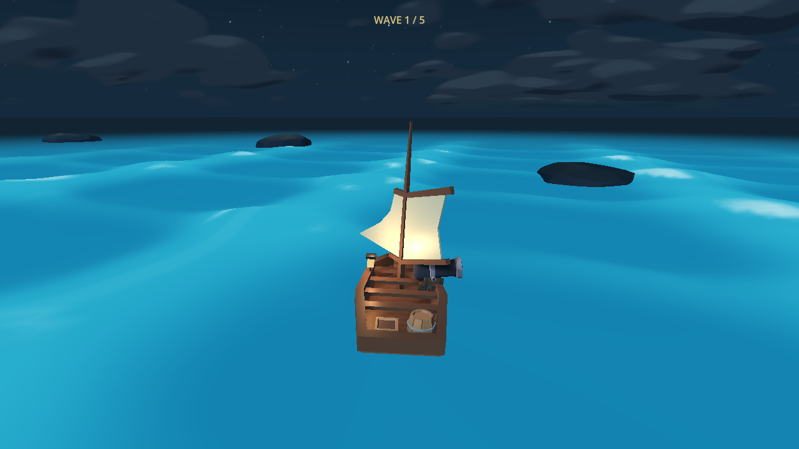
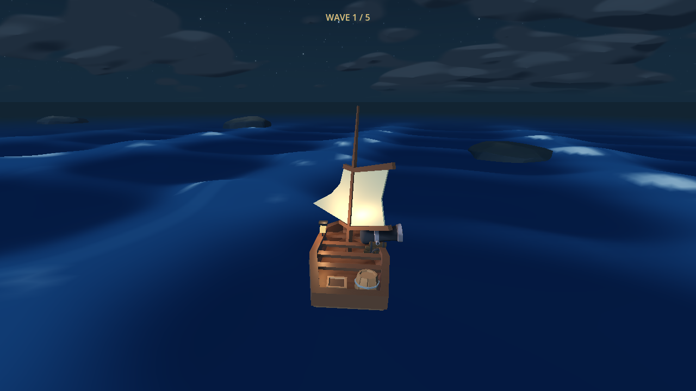
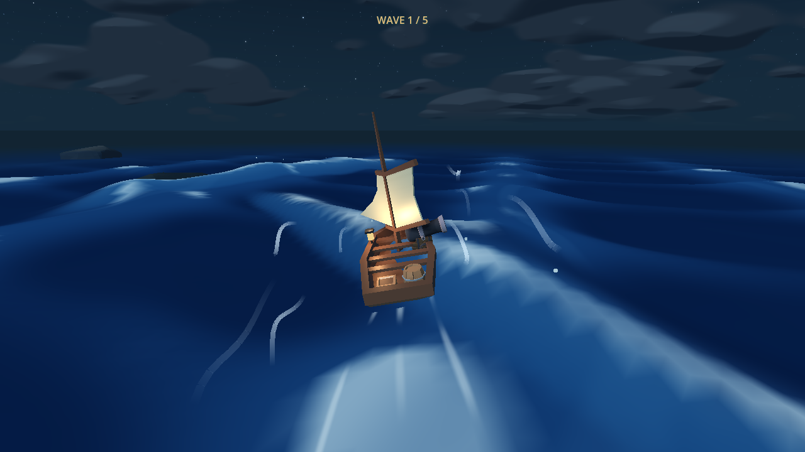
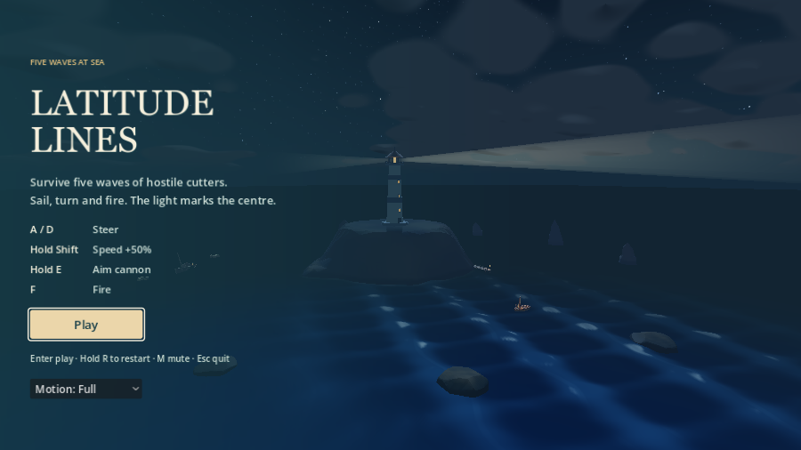
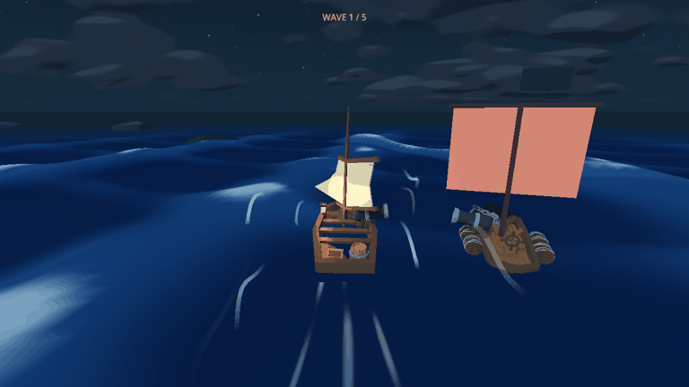

# Dark night water, continuous Shift boost and arena waves

18 October 2026. Follow-up to the existing water/flow work on
`codex/turquoise-water-flow-plan`, draft PR #9. Earlier +25% Shift tuning is
superseded by the user's final **+50% while held**, with a visible tailwind.

The player sees navy water with pale blue caps, chooses when to hold Shift for
extra speed, and countersteers recurring visible crests even during combat.
The baseline already supplies shared analytical water, 7.5 m/s cruise, persistent
once-per-zone flow rewards, planar collisions and the restored chase camera.
Only palette, held boost/feedback and arena wave scheduling change here.

| Requirement / invariant | Changed files | Observable evidence |
| --- | --- | --- |
| Dark blue night water; existing waves merge with it | `calm.tres` | Matched native before/after at clock 18; actual scheduled wave and cannon views inspected. Palette #07132C / #0C244A / #18416D / #396A95, foam #B4D4E5. Height multiplier remains 0.88. |
| +50% throughout held Shift; immediate return on release | `crossing.gd` | Real physical Shift press/release at 30/60/120 Hz measures 7.5 -> 11.25 -> 7.5 m/s. Key echo never stacks. A continuous 12-second hold retains boost; there is no timer/cooldown/resource. |
| Tailwind while held | `boost_wind.gd`, `crossing.gd` | Eight bounded pale ribbons, four in Reduced motion; native frame sequence inspected. No Shift / permanent flows alone produce no indicator. Release fades it within 0.15 s; focus loss/retry/sinking clear it immediately. |
| Keep earned flow speed and current controls | `crossing.gd`, `navigation_hud.gd` | Three permanent rewards give 14.6484375 m/s; Shift raises this to 21.97265625, release restores 14.6484375. Damage retains both; real sinking clears them. A/D works with boost; E retains existing suspended rudder; no F means no shot. Menu lists Hold Shift / Speed +50%. |
| More frequent real pushing waves in arena | `wave_encounters.gd`, `ocean_controller.gd` | Real director clock launches first at 6.70 s and eight crests in 60 s while an actual enemy and cannon aim are active. Maximum two simultaneous in this fixture, capped at four. Four full-drain recovery intervals last 4–6 s. |
| Visible wave -> actual force, preserved countersteering | Existing shared wave field and sailing integrator retained | Automatically scheduled moving-boat encounter measures peak drift 2.4568 m/s and yaw 0.56 rad/s, with zero hull hits. Disabled-trigger control has no launches or hidden drift; existing wave suite verifies timely/late/no countersteering and frame-rate parity. |
| Shelter, lifecycle and fast boundary return | `wave_encounters.gd`, `crossing.gd` | No waves launch inside 40 m island shelter or in title state. Full stacked flow + held Shift remains inside arena through the curved return. Retry clears field/history/clock/input. |

## Executed validation

Godot 4.8.dev7, installed Windows executable. From repository root:

```text
godot --headless --path ldjam_60 --fixed-fps 60 --script res://tests/<suite>.gd
```

| Suite | Checks | Result |
| --- | ---: | --- |
| night_boost_wave_smoke | 47 | Pass |
| flow_zones_smoke | 74 | Pass |
| wave_encounter_smoke | 33 | Pass |
| ocean_smoke | 40 | Pass |
| cannon_aim_smoke | 79 | Pass |
| controls_lifecycle_smoke | 46 | Pass |
| sailing_camera_smoke | 43 | Pass |
| survival_smoke | 80 | Pass |
| hud_smoke | 59 | Pass |
| **Total** | **501** | **No failures** |

HUD's old four-control expectation was updated to include Shift. The new combat
fixture initially omitted polling held E through the game loop; corrected it to
exercise actual aim state. Final results above are after those fixture repairs.

Native Compatibility rendering, Intel Graphics:

```text
godot --path ldjam_60 --fixed-fps 60 --script res://tests/night_boost_previews.gd
```

The preview performs real scheduled-wave sailing with active enemy combat and
held Shift, then releases Shift and enters cannon view. It temporarily protects
the player from damage to keep the capture running; it is not a combat victory
or human playtest. Before palette is an explicit replay of fa0fc64 colors at the
same camera, wave clock and height settings. Raw logs, frames and measurements
are ignored under `build/night_shift/`; selected captures below are durable PR
evidence.

| Before | After |
| --- | --- |
|  |  |







Human fun, balance and comfort remain unverified. No Web profiling or human
playthrough was performed. Shared CPU/GPU wave equations are unchanged; this
follow-up did not rerun the earlier GPU parity capture. The earlier report's
legacy coastal-mask hash mismatch and variable performance remain separate
known gaps. Existing damage, cannon, camera, survival and lifecycle regressions
were exercised; scripted passes do not establish final difficulty.
