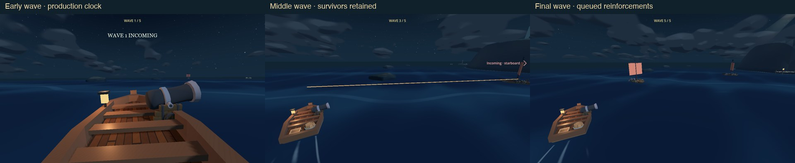
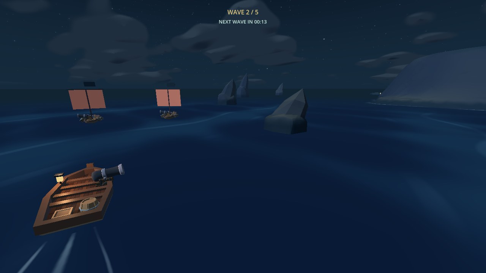
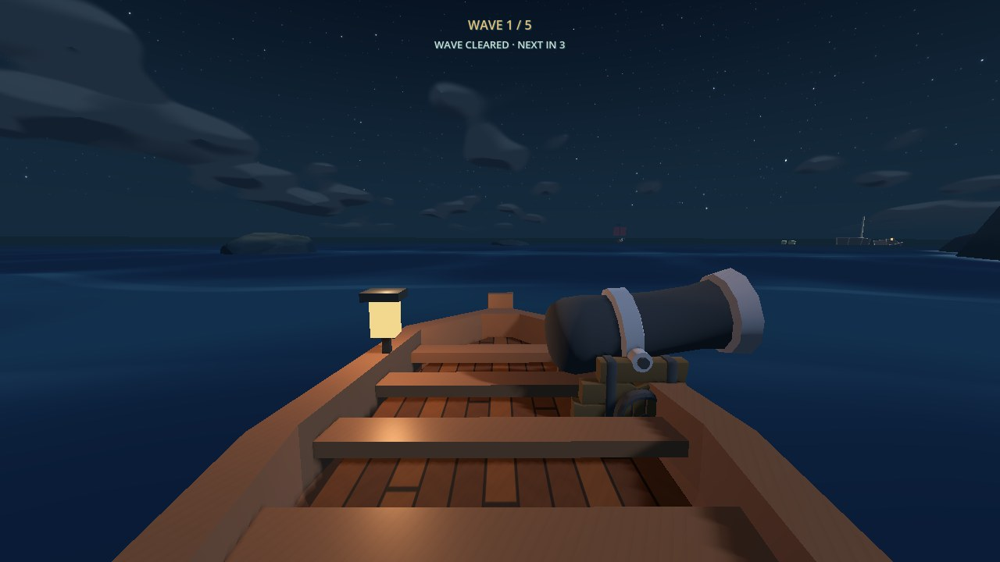
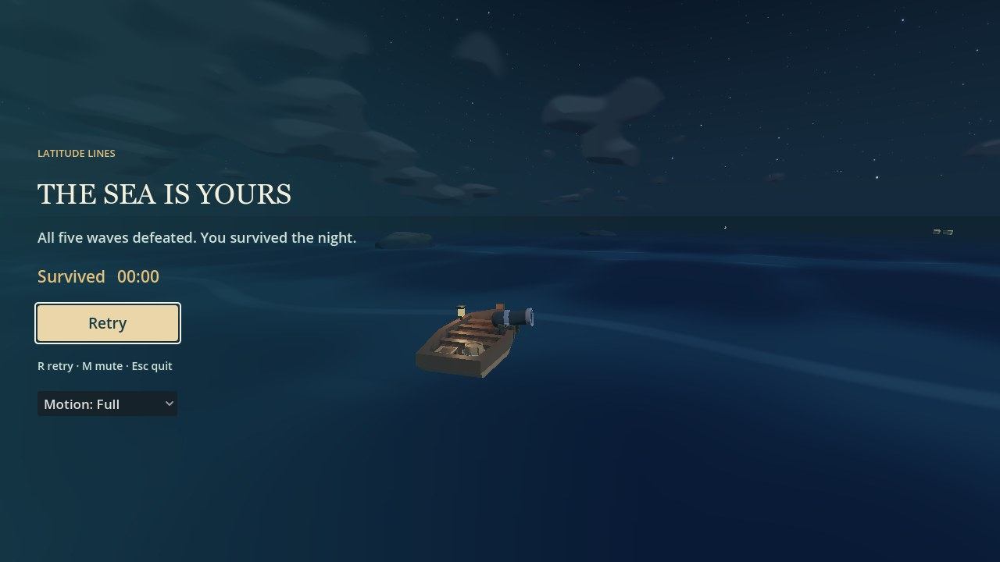
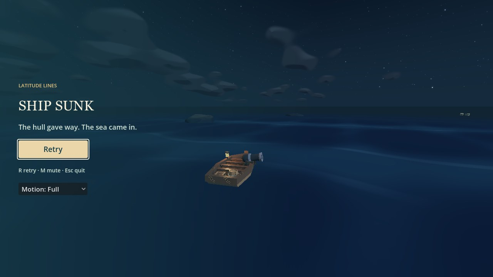

# Five timed survival waves — 18 October 2026

Continues [PR #5](https://github.com/kickflip-games/ludum_dare_60/pull/5) on
`hacking/lighthouse-arena`, from arena base `dd1d45b`. This replaces the pending
lighthouse-health proposal and the earlier one-cutter scheduler. The lighthouse
is atmospheric: enemies target only the player. The separate voyage PR #6 by
EL-MZ and the local splash settings were left untouched.

## Player experience and fixed rules

| Wave | Cutters | Next-wave deadline |
| --- | ---: | ---: |
| 1 | 1 | 40 s |
| 2 | 2 | 50 s |
| 3 | 4 | 65 s |
| 4 | 6 | 80 s |
| 5 | 8 | All 21 required enemies must be defeated |

- Each countdown starts when its wave begins. Expiry adds the next wave's queue;
  it never despawns survivors, restores enemy health, grants kills or repairs.
- At most three living combatants. Queued ships arrive from the authored sectors,
  normally eight seconds apart, with 65 m player / 25 m ship separation and
  terrain/obstacle/boundary clearance. Blocked locations defer the arrival.
- An all-clear before the current deadline, with no pending spawn or incoming
  shot, restores one capped hull point and starts a three-second pause. The next
  wave can then arrive without an extra leftover spawn cooldown. Original
  automatic repairs still require a genuine safe interval.
- Three pooled cutters preserve sinking animations and incoming shots before
  reuse. Final victory waits for every queued/live enemy, exact kill accounting,
  sinking and incoming shots. A last lethal shot takes precedence over victory.
- The 170 m arena, obstacles, return turn, wave authority, weapon, hull effects
  and controls remain shared. No new archetypes, upgrades or navigation HUD.

## Changed files and acceptance

| Requirement | Implementation | Controlled evidence |
| --- | --- | --- |
| Counts, deadlines, stagger, cap | `survival_settings.gd/.tres`, `enemy_encounters.gd` | Exact 1/2/4/6/8 roster; 40/50/65/80 clocks; 21 genuine impact-driven kills; three-live cap and configurable two-live control; 30/60/120 Hz; eight-second arrival gap |
| Timed overlap without free kills | Shared FIFO queue and per-wave spawned/defeated records | Damaged first-wave ship survives into wave two unchanged; at wave five, three living + 18 pending remain without firing |
| Early clear and repairs | Explicit early-clear phase, capped `restore_hull(1)` | Early pause/start at three seconds; pending spawn blocks clear; no reward on expiry, no repeat reward, cap control; original safe-period repair |
| Sustained multi-ship combat | `enemy_ship.gd`: existing broadside/shot logic, neighbour feelers and physical ship collision; no arena timeout retreat | Non-primary cutter sees another hull, targets predicted player course, preserves locked non-homing shot, and physically damages player; real-AI no-input control |
| Shared presentation and sea | `crossing.gd`, `navigation_hud.gd`, `ocean/wave_encounters.gd` select from all cutters | Non-primary telegraph drives warning/camera selection and blocks repair; wave/reticle/damage regressions; native early/middle/final views |
| Minimal UI and endings | Top-centre label, final-15-second clock, two-second fading announcement and low existing audio cue | Exact text, visibility and fade assertions; real 1280×720 review; THE SEA IS YOURS / SHIP SUNK |
| Lifecycle and safe completion | Pool reset, queue/record/timer/banner cleanup; incoming-shot drain before final clear | Combat/intermission/victory/defeat/repeated retry; keyboard R after victory; no duplicate target instances; lethal and harmless pending-shot controls |
| No obsolete objective | Existing voyage/arrival gates retained; no lighthouse health object | Arena no-harbour-victory check, missing-health-state assertions, no-input non-victory |

The `.ship` compatibility reference remains for historical single-cutter
fixtures and an empty-pool fallback. Normal HUD, camera, repair and sea scheduling use all
cutters. Counts, durations, interval, cap, clear pause and separations are editable
in `survival_settings.tres`. Retry retains tuning and clears session state.

## Actual validation

- **740 checks passed** across fourteen suites: survival **80**, arena **132**,
  twelve adjacent suites **528**. All exited successfully with no failed
  assertions or script errors.
- Exact-count/overlap control reaches final wave with three living cutters and
  18 queued arrivals, zero free kills. The controlled complete run spawns and
  genuinely sinks all 21 required cutters through cannon impact handling.
- Default no-input real sailing/AI ended in defeat after **225.42
  simulated seconds**, with zero kills and a peak of three living enemies.
- Native early/middle/final gameplay, countdown, early-clear and both ending
  fixtures were captured and inspected at 1280×720. Import and diff checks pass.
  No script or shutdown-leak warnings occurred in the final native run.
- Sandboxed headless runs print the installed runtime's macOS certificate-store
  warning; it did not prevent import or any test from completing.

Commands use installed Godot 4.8-dev6 (`8898c2b3d`):

```sh
godot --headless --path ldjam_60 --fixed-fps 60 --script res://tests/survival_smoke.gd
godot --headless --path ldjam_60 --fixed-fps 60 --script res://tests/arena_smoke.gd
godot --headless --path ldjam_60 --fixed-fps 60 --script res://tests/<suite>_smoke.gd
godot --path ldjam_60 --fixed-fps 60 --script res://tests/survival_previews.gd -- --output=/tmp/latitude-timed-waves/rendered
```

Adjacent suites: cannon_aim, combat, recovery, controls_lifecycle, wave_encounter,
damage, sailing_camera, hud, archipelago, ship, turbulence_camera and ocean.
Their historical-voyage assertions are retained. The normal-scene arena and
survival suites exercise the current mode separately.

The first UI assertion run exposed a fixture that set the wave timer without
refreshing its derived countdown; the fixture now invokes the scheduler before
checking presentation. No acceptance gate was relaxed. A short initial end-screen
capture also caught the menu during its fade; final captures allow the real fade
to finish. Early clears now suppress an unfinished incoming announcement.

## Rendered review and limits

Actual native Compatibility renderer, Apple M4 Pro, 1280×720. Early/middle/final
captures follow real A/D sailing, cutter AI and the production wave clock with
damage protection so review can reach later waves. Protection is a fixture only.
This demonstrates rendering, queue continuity and UI; it is not a won playthrough.
The early-clear/end-screen views explicitly stage kills through the real impact
handler and shorten the fixture spawn interval. No claim of human victory or
combat balance follows from them.

- Top-centre labels remain small; the countdown/announcements do not cover the
  reviewed targets, cannon or incoming-fire area. Normal rock occlusion remains;
  the final combat view was captured when at least one cutter had a clear view.
- The 21-kill lifecycle test uses real damage/impact handling, while existing
  arena/cannon tests separately verify real E/F projectile flight and hits.
- The no-input runtime is bounded at five minutes or defeat, whichever occurs
  first. It cannot satisfy victory without kills.
- Human full-run playtesting, difficulty/fairness, horn audibility and
  browser/mobile performance remain untested. No remaining-target HUD was added
  without playtest evidence that it is needed.
- Raw captures, state metadata and logs are local under `/tmp/latitude-timed-waves/`.
  Only small review images needed for web-visible PR evidence are committed.



| Scheduled countdown | Early clear |
| --- | --- |
|  |  |

| Victory fixture | Defeat fixture |
| --- | --- |
|  |  |

[Final announcement](timed_survival/wave-5-incoming.jpg) ·
[Preserved arena geometry evidence](lighthouse_arena_review.md)
