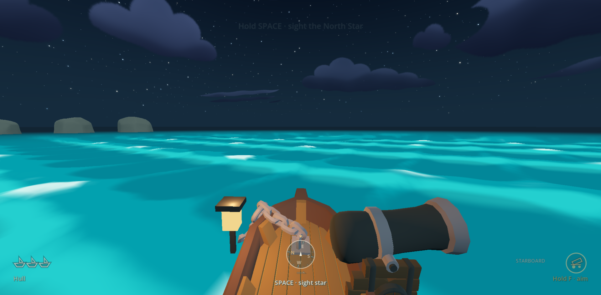
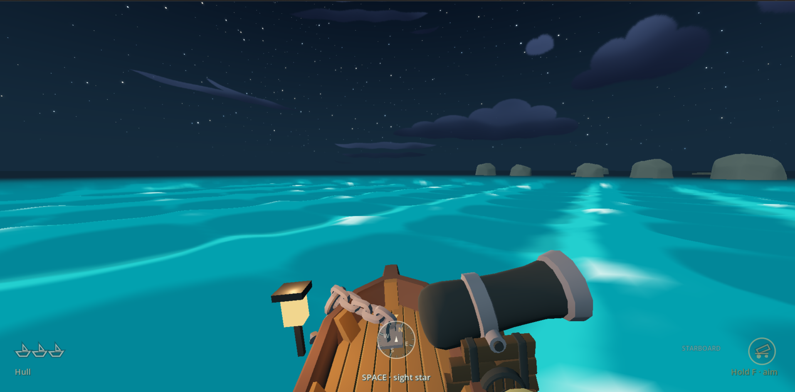
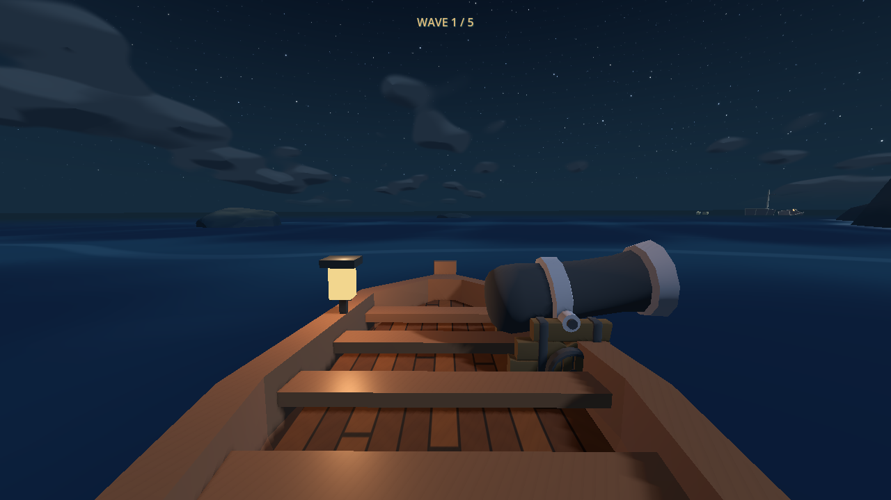
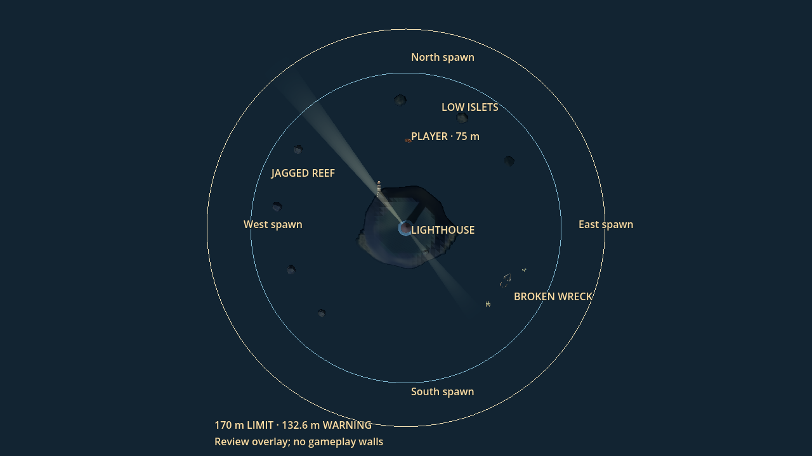

# Turquoise water and flow zones — design proposal

18 October 2026. Approved and implemented; see the
[implementation report](turquoise_water_flow_report.md) for current evidence.

Final user updates: base speed **7.5 m/s**; each distinct zone compounds it by
25% once per run; directional wave force **50% stronger**; rolling-water
modulation **4x the first implementation's amplitude** (0.22 -> 0.88).
The final palette is a slightly darker **night blue**, replacing the earlier
turquoise pass while retaining brighter flow ribbons and cool pale foam.
Implementation incorporates latest upstream arena/chase-camera changes at
`84ac328`. The source baseline below records the earlier planning inspection.

## Scope

Restore the supplied references' turquoise water, broad moving surface bands and
small pale crest caps. Make the existing directional waves share that style.
Add visible optional flow zones that grant 25% more forward sailing speed.
**The boost persists after leaving the zone**, until the run ends or restarts.
**Each distinct zone grants another 25% of the current forward speed, once per
run.** Revisiting a collected zone grants nothing. These rewards compound:
`forward_speed = base_speed * pow(1.25, collected_zone_count)`.

Base: latest `origin/main`, `61ba63f`, the lighthouse survival arena. Preserve
the arena, timed cutter waves, steering, cannon controls, damage and retry.
The separate draft [journey PR #6](https://github.com/kickflip-games/ludum_dare_60/pull/6)
by EL-MZ overlaps movement, water and speed boosts; do not import that voyage or
its 9.5/12.5 m/s wind system into this arena plan.

## Player experience

The sea should visibly roll beneath the boat throughout play, with the saturated
cyan/turquoise bands and small pale caps in the supplied screenshots. Incoming
directional crests should look like larger movements of that same sea. The
player reads their direction and turns into or counters them with A/D.

Flow zones offer an optional early routing decision during arena combat: take
a clear-water detour to earn sustained speed for repositioning and cannon passes.
After collection, the player can leave freely and retain the benefit. Faster
travel also increases turning radius and approach speed near reefs; it must not
turn arena return into an unavoidable crash. Benefits to fun, difficulty and
comfort need a human playtest, rather than being inferred from a screenshot.

## Baseline inspected during planning at 61ba63f

| System | Current behavior and source |
| --- | --- |
| Normal play | `game/crossing.tscn` enables the lighthouse survival arena. The five timed enemy waves, obstacles and 170 m boundary are already implemented. Voyage navigation is inactive. |
| Forward speed | `crossing.gd:SPEED` is 6.3 m/s; `ocean/wave_sailing.gd:step()` separately hardcodes 6.3 in both integration velocities. `arena_return.gd:rudder()` also assumes 6.3. No flow/wind-zone system exists on main. |
| Surface | `ocean/presets/calm.tres` sets height multiplier 0.095 and disables ambient foam. Its conservative ambient displacement bound is about 0.116 m. The preset overrides the default palette with subdued blues. |
| Style | `sea.gdshader` already uses actual sampled height, signed crest slope and normals for broad bands. Additional fixed turquoise turbulence colors and a general darkening multiplier can prevent a palette-only edit from matching the reference. |
| Authority | `wave_settings.gd`, `wave_field.gd`, `waves.gdshaderinc` and `ocean_controller.gd` share surface shape/time for visuals, flotation and cannon-water contacts. Horizontal collision stays planar. |
| Directional pressure | `wave_field.gd:push_at()` drives drift/yaw from finite visible events, not ambient shader decoration. Rudder authority is 0.72 rad/s; wave yaw caps at 0.56 rad/s; four events maximum. |
| Arena crests | `wave_encounters.gd` shelters the inner 95 m. Outside, occasional terrain-checked ambient crests can launch when combat/cannon gates permit. Old regional ten-crest sets are inactive in arena play. |
| Controls and reset | Automatic forward sailing, A/D or arrows, hold E / press F, held restart and Full/Reduced motion are retained. `crossing.gd:restart()` clears motion, encounters, camera contacts and transient effects. |

Historical ocean documentation includes old palettes and voyage descriptions;
the preset, arena branch and production code above take precedence.

## Proposed water changes

1. **Restore the reference palette across the surface.** Start with deep cyan
   `#00899D`, main turquoise `#009FAB`, moving faces `#20BFC3`, light crests
   `#5CD7D5`, and restrained pale mint foam `#E2F6EC`. These are visual starting
   swatches, not exact recovered shader values. Tune in the real renderer against
   the references. Preserve a smooth dark horizon and readable rock silhouettes,
   cannon warning lines and shots under calm and storm lighting.
2. **Bring back visible rolling modulation.** The final requested multiplier is
   0.88 (4x the first implementation's 0.22), with an ambient bound of 1.077 m,
   with broad dominant wavelengths around 20-30 m and secondary 10-16 m rolls.
   Keep the analytic shape and derivative shared; use the existing five-point
   hull response. Add sparse broken caps, with broad moving cyan bands between
   them. Avoid uniform white noise or an always-stormy sea. Tune the boat ride
   using Full and Reduced motion, especially the gunner view.
3. **Blend existing directional waves into the same design.** Use the same
   palette for their troughs, backs, advancing faces, foam, wake and water-impact
   effects. Replace conflicting fixed turbulence tints with palette-derived
   variants; keep a readable brighter advancing face and narrow pale cap.
   Preserve timing, profile, countersteering and the four-event cap; multiply
   directional crest force by 1.5, retaining the existing wave-turn cap.
4. **Keep the navigation challenge explicit.** Background rolls supply the
   continuous ride and readable surface; existing finite crests supply real
   drift/yaw. Route choice through flow zones adds a lasting reward. Do not add
   invisible ambient currents, random turning, another force model or change
   the arena's combat-gated crest scheduler as part of this patch.

## Proposed persistent flow zones

- Begin with three optional, distinct curved patches in unobstructed arena water,
  approximately 18-24 m wide and 40-60 m long. Pick final poses after clearance
  checks against the reef, wreck, low islets, enemy arrivals and player spawn.
  Keep each complete footprint within about 125 m of the lighthouse, before
  the return-assist threshold of 132.6 m. Leave several safe routes around them.
- Make each patch visible ahead as a brighter cyan ribbon with orderly moving
  filaments and pale broken edges. Match the actual water surface and wave time;
  do not float a flat luminous plane above passing waves. World placement and
  membership must agree with the rendered footprint.
- Give every zone a stable unique ID. On first entry, add its ID to the session's
  collected set and recompute speed from base speed and set size. Leaving a
  patch never clears its reward. Standing inside or revisiting a collected zone
  grants nothing; entering a different uncollected zone grants one more 25%.
  Overlapping fresh zones each grant once, independent of iteration order or
  frame rate; repeated frames cannot duplicate either grant.
- With the initial three zones, forward propulsion progresses through
  **7.5 -> 9.375 -> 11.71875 -> 14.6484375 m/s**. Every collected reward lasts
  through the rest of the run. Wave drift stays separate;
  actual ground speed still reflects turning, collisions and boundary handling.
  E aim/release and accepted nonfatal damage must not cancel the reward.
- Use one authoritative forward-speed value in wave integration, arena return
  prediction and relevant movement probes. Preserve collision sweeps, the arena
  hard limit, inward steering and the existing cannon-control priority.
- Give a short entry sound, a brighter moving wake and one brief `Flow +25%`
  acknowledgement for each newly collected zone. After collection, soften that
  spent zone visually so it does not advertise another reward. Keep feedback
  legible against incoming-fire
  warnings; no permanent speed HUD or new control is needed.
- Win/loss clears active speed state; retry restores normal speed, clears the
  collected-ID set, and restores every zone's reward and entry feedback.
  New sessions start outside all boost footprints.
  Zones affect the player only; enemy speed, projectile speed, reloads, damage,
  timers and the five-wave survival rules stay unchanged.

The number and placement of patches, palette, foam coverage and roll amplitude
are tunable. Persistent exit behavior, 25% compounding for each distinct zone,
one reward per zone per run, and preserved controls/surface authority are fixed.
The number of authored zones bounds the available rewards; no separate speed
cap is proposed. Test arena return at the full three-zone speed, not just the
first boost, and tune zone placement or return prediction if needed.

## Small implementation scope after design agreement

- `game/ocean/presets/calm.tres`, `wave_settings.gd`, `sea.gdshader`: ambient
  roll and unified palette. Keep `wave_field.gd` / `waves.gdshaderinc` equations
  matched; changing only shared settings should avoid new wave equations.
- `game/world/arena_layout.tscn`: editable zone markers beside the existing
  obstacle/sector authoring. Add a small bounded `game/flow_zones.gd` for
  membership, collected-zone/session state and shader parameters.
- `crossing.gd`, `wave_sailing.gd`, `arena_return.gd`: authoritative speed,
  integration and reset. Audit `archipelago.gd` return/collision probes for
  assumptions about speed or stopping distance. Flow visuals should reuse
  the ocean material rather than add a separate wave-displacement system.
- Existing wake/effect/audio integration: reuse bounded resources for feedback.
  Add a focused flow smoke test and a deterministic native preview fixture;
  update the ocean README, root README and changelog with actual final behavior.
  No architecture replacement, new assets/dependencies or navigation redesign.

## Requirement-to-evidence contract

This table records the acceptance contract; actual passing checks and the
inherited legacy-foam limitation are in the implementation report.

| ID | Requirement / invariant | Trigger / control case | Observable expected result and acceptance evidence |
| --- | --- | --- | --- |
| R1 | Reference color and rolling modulation | Sail in calm/storm at matched camera/time; compare unchanged baseline | Broad turquoise moving bands, sparse pale caps and a visible gentle hull ride; readable horizon, reefs and shots. Native frames plus a short moving clip inspected. |
| R2 | Existing waves merge with the surface | Stage port, starboard and four overlapping crests, then recovery | Same palette, visible advancing faces, smooth spatial/temporal blend; original countersteering remains effective. Native captures plus `wave_encounter_smoke.gd`. |
| R3 | Each distinct zone grants 25% of current propulsion | Same straight clear-water run with/without actual crossings of three different zones | Forward targets are 7.5, 9.375, 11.71875 and 14.6484375 m/s after zero/one/two/three zones; no-zone control never boosts. Check displacement, not a visual flag alone. |
| R4 | Every boost survives exit | Leave each collected patch; continue in clear water, aim/release, accept nonfatal damage | Forward target remains `7.5 * pow(1.25, collected_zone_count)`; wake/feedback agree. No requirement to remain in or return to a patch. |
| R5 | Each zone rewards once per run | Stay inside, overlap two fresh patches, cross borders repeatedly, revisit spent zones; collect in different orders | One grant per distinct ID; two fresh overlapping zones grant exactly two boosts. No per-frame/re-entry multiplication. Zone order does not change the final speed. |
| R6 | Collision and arena safety at every reward level | Sail at zero/one/two/three boosts toward reef/props and outward rim; mixed A/D with E; repeat 30/60/120 Hz and a long frame | Solids still stop/slide movement; bounded return and inward steering remain available; speed reward never bypasses collision or boundary. `arena_smoke.gd` plus focused boosted scenarios. |
| R7 | State lifecycle | Fresh start, damage, sinking, victory, held restart/retry | Nonfatal damage preserves boost; endings stop movement and clear reward; retry restores 7.5, zone eligibility, audio/camera/effect state. `controls_lifecycle_smoke.gd`, `damage_smoke.gd` and new flow tests. |
| R8 | Shared sea and combat/navigation preservation | Sample both surfaces, fire into moving water, steer/counter crest, play representative survival circuit | CPU/GPU heights/normals agree; splashes meet water; muzzle/controls and five-wave timing/queues still work. `wave_render_check.gd`, `ocean_smoke.gd`, `cannon_aim_smoke.gd`, `survival_smoke.gd`. |
| R9 | Readable and bounded presentation | Approach uncollected/spent patches with incoming fire; Low/Standard, Full/Reduced | Visible footprint agrees with collision-root membership, no clipping/flicker or ambiguous reward, clear warnings. Native review and paired frame-time/draw-call measurements; no unbounded allocations. |

Acceptance requires both positive and control runs. Countersteering and boosted
survival runs must use real steering/input rather than teleporting or disabling
collisions. Scripted success does not establish human fun, fairness or comfort.
Web performance must be measured before claiming browser acceptance.

## Review evidence and current status

The supplied screenshots are visual references, not gameplay requirements for
their old HUD, controls or boat framing. They contain no project instructions.
Two durable reference copies are included specifically for web review; raw
runtime outputs remain ignored under `build/`.

Native unchanged baseline, captured on this branch with the existing arena fixture:

- Open PRs including drafts checked; relevant #6 description, author and changed
  files inspected, and overlap reported before implementation.
- Latest main fetched; separate branch created from `61ba63f`; draft PR opened
  with the initial proposal before any gameplay implementation.
- Source/settings/history review completed. Old water colors and denser ambient
  waves exist in history, but copying old scripts would regress newer systems.
- Ran Godot 4.8-dev7 with `--path ldjam_60 --fixed-fps 60 --script
  res://tests/arena_previews.gd -- --output=build/water_flow_plan_baseline`.
  The fixture generated all ten named views plus the return sequence. Inspected
  the native spawn/helm and overhead PNGs: dark subdued water and current arena
  layout confirmed. The fixture stages views and disables encounters for most
  captures; this is launch/render evidence, not a human combat playtest.
  Raw outputs were moved to ignored root `build/water_flow_plan_baseline/`;
  only the two selected baseline views are retained for durable web review.
- Documentation whitespace check (`git diff --check`) passed. No gameplay
  smoke suite was rerun for this documentation-only proposal.
- GitHub-rendered proposal inspected, including the persistent-flow section;
  its [review screenshot](turquoise_water_flow/proposal-review.png) is retained
  for the draft PR. Reference and baseline image links resolve in the repository.
- Implementation is now authorized and delivered; see the linked implementation
  report for current code, exact test outcomes, native captures and remaining
  human playtesting / Web performance gaps. The bullets above record planning
  evidence rather than claiming they validate the final gameplay.
