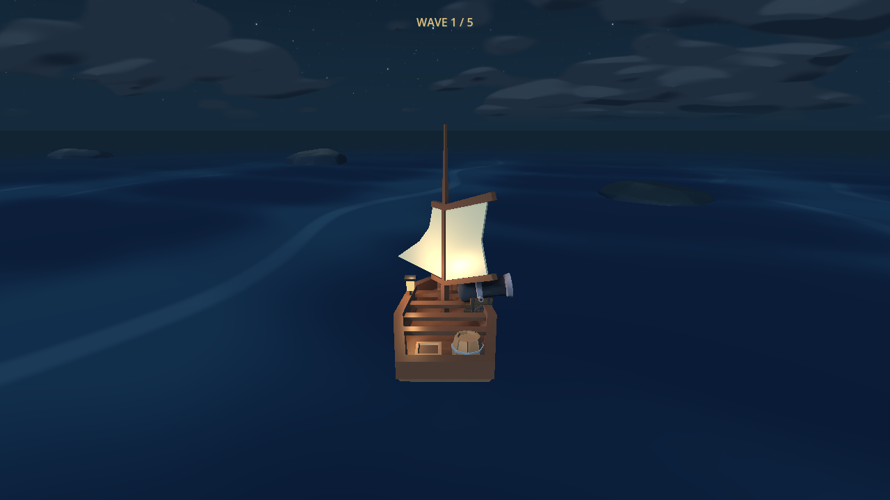
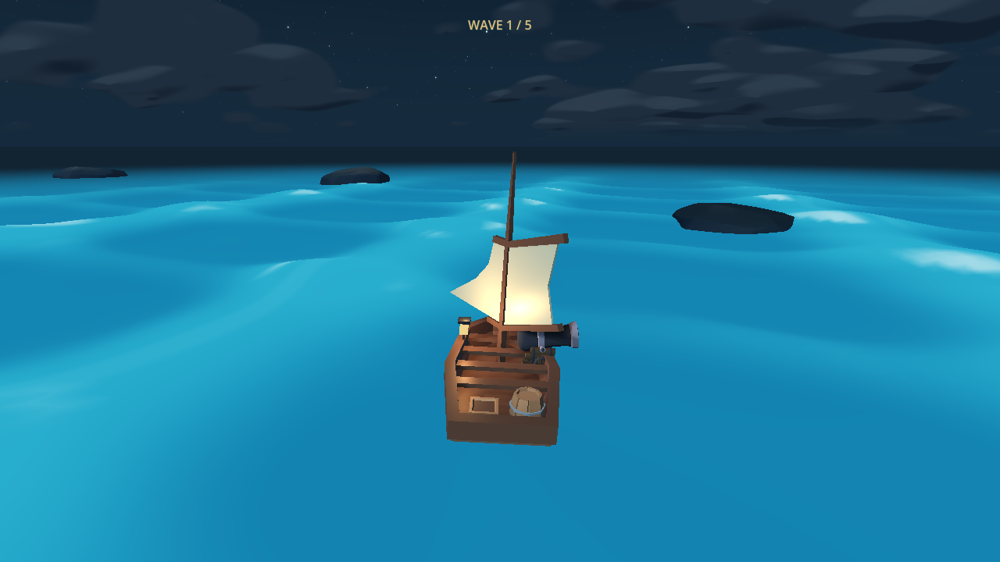
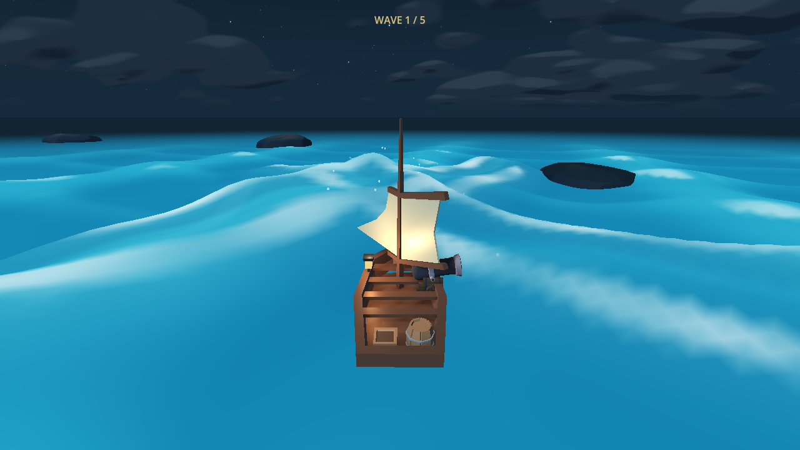
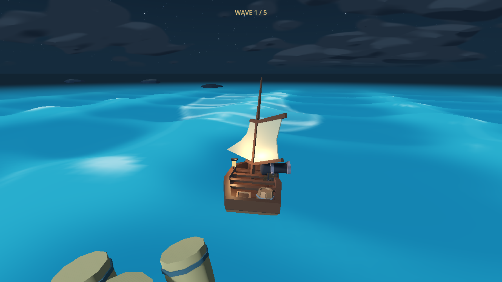
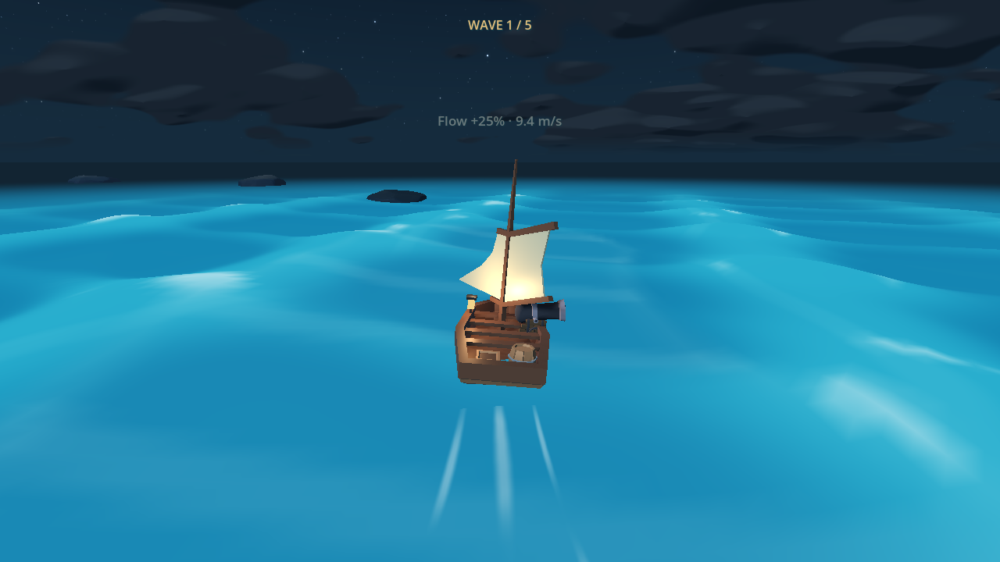
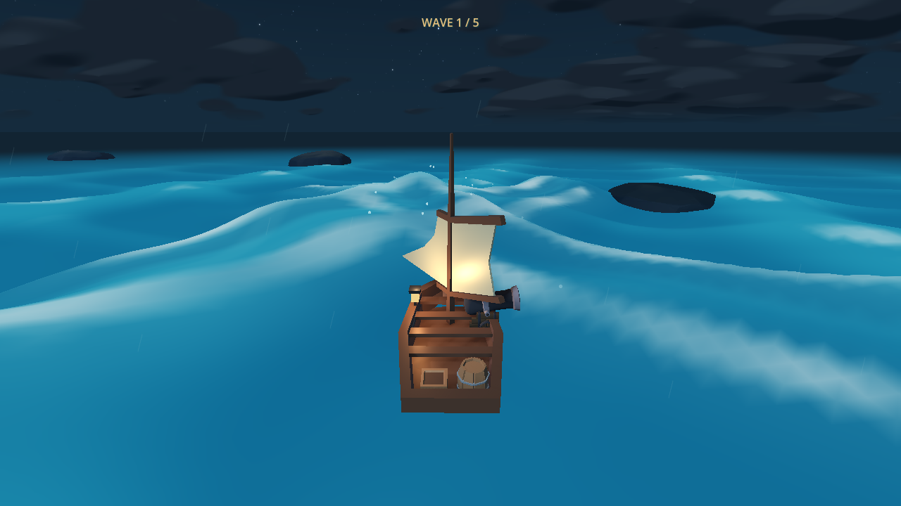
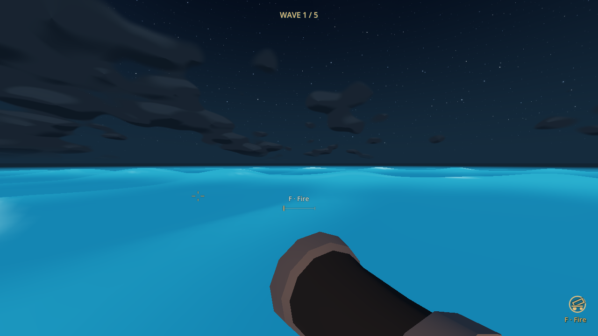

# Night-blue rolling water, persistent flow rewards and stronger waves

18 October 2026. Implemented on `codex/turquoise-water-flow-plan` after merging
upstream `84ac328`. The second requested pull reported already up to date.
The approved [plan](turquoise_water_flow_plan.md) is updated with final tuning.

## Result

- Base player speed is **7.5 m/s**. Three authored, visibly flowing curved ribbons
  grant **25% of current forward speed once per distinct zone per run**:
  **9.375 -> 11.71875 -> 14.6484375 m/s**. Rewards survive exit, aiming and
  nonfatal damage. Collected IDs prevent standing, overlapping/re-entering or
  frame rate from duplicating rewards. Win/loss and held-R retry reset them.
- The final user-requested slightly darker **night-blue** palette covers the
  sea and existing finite crests, replacing the initial turquoise pass. Broad
  rolling bands, cool pale caps and matching wake/splash foam remain.
  User-requested **4x modulation** means height multiplier **0.88**, four times
  the initial implementation's 0.22. The ambient displacement bound is 1.077 m;
  this is a bound, not the height of every wave.
- Directional wave force is **exactly 1.5 times the former force**, including
  saturated cases: scaling occurs after the old 8-unit limit. Wave geometry,
  time and lifetime are unchanged. Rudder authority 0.72 rad/s and wave yaw cap
  0.56 rad/s remain, preserving countersteering rather than granting hidden yaw.
- Retains upstream's restored chase camera, survival waves, E/F cannon controls,
  enemy tuning and planar swept collisions. Boundary return anticipates stacked
  speed; obstacle probes scale their lookahead. A swell can honestly stop a low
  shot before a target. No automatic shot correction was added.

## Requirement and evidence

| Requirement | Changed files | Actual evidence |
| --- | --- | --- |
| Night-blue bands, stronger rolling modulation, consistent crest color | `calm.tres`, `sea.gdshader`, `wake.gdshader`, `broadside_cannon.gd` | Native before/after, four-crests, storm, cannon, Low and Reduced views inspected. Ocean test measures 1.096 m heave range at its fixed pose, within surface bounds. |
| 7.5 base and 25% for each fresh flow zone | `flow_zones.gd`, `arena_layout.tscn`, `crossing.gd` | Real approach into every authored ribbon at 30/60/120 Hz; displacement confirms every reward level. No-zone controls retain 7.5. |
| Persistent exit, once per ID, reset lifecycle | `flow_zones.gd`, `crossing.gd`, `enemy_encounters.gd` | Order, overlap, standing/re-entry, damage, held E, held R, sinking, scheduler victory and retry checked. Native nine-second EastFlow pass exits with measured 9.374999 m/s and one collected ID. |
| 50% stronger force with usable countersteering | `wave_field.gd` | Independent old-force calculation verifies exact 1.5 gain for one and four saturated crests; no-contact control remains zero. At 7.5 m/s countersteering reduces sideways error 29.488 -> 4.304 m; at 14.648 m/s, 3.590 -> 0.352 m. 30/120 Hz comparisons pass. |
| Faster sailing remains bounded and collides | `arena_return.gd`, `archipelago.gd`, `crossing.gd` | All four speed levels pass open-rim return at 30/60/120 Hz; long frame plus drift remains bounded. Full-speed wreck approach records a collision rather than tunnelling. All authored ribbon footprints have hull clearance inside 125 m and away from spawn. |
| Same surface for rendering, boat and projectiles | shared existing wave samplers; settings and flotation support | **51,840 CPU/GPU height/normal components pass**, maximum error **0.000198**. Native minimum sampled camera clearance is 1.853 m. Low shot versus visible rolling-swell negative control passes; real E/F clear-water shot hits the cutter. |
| Preserve ride, combat, controls and reset | bounded 0.50 m edge support in `boat_wave_motion.gd`; movement integration | Full/Reduced have identical physics. Hull angle limits, gunwale/water clearance, chase reset, actual cannon hits, damage, survival timers/queues/endings and retry pass their relevant suites. |

The sprite/particle pools and wave-event count stay bounded. Flow colors are
drawn in the existing displaced water shader. Heading sines/cosines are computed
once on the CPU; vertices outside each ribbon's bounding box skip detailed
distance/streak shading. Material updates are cached until active/collected
state changes. No extra water plane, imported assets or dependencies were added.

## Actual checks

Godot **4.8-dev7**, native Compatibility renderer, 1280x720 on Intel integrated
graphics. **640 checks passed across twelve suites**, zero failures or engine
errors in their final logs:

| Script under `ldjam_60/tests/` | Passing checks |
| --- | ---: |
| `flow_zones_smoke.gd` | 74 |
| `arena_smoke.gd` | 139 |
| `survival_smoke.gd` | 80 |
| `cannon_aim_smoke.gd` | 79 |
| `controls_lifecycle_smoke.gd` | 46 |
| `ocean_smoke.gd` | 40 |
| `wave_encounter_smoke.gd` | 33 |
| `dynamic_wave_smoke.gd` | 18 |
| `sailing_camera_smoke.gd` | 43 |
| `turbulence_camera_smoke.gd` | 37 |
| `damage_smoke.gd` | 38 |
| `turbulence_effects_smoke.gd` | 13 |

Native `wave_render_check.gd` passed the 51,840-component GPU comparison;
`flow_water_previews.gd` completed its fixed views, Low/Reduced cases, real-input
flow pass and 18-frame moving-water sequence. Project import and whitespace
checks passed.

Each smoke suite was run with:

```sh
godot --headless --path ldjam_60 --fixed-fps 60 --script res://tests/SCRIPT_NAME.gd
godot --path ldjam_60 --fixed-fps 60 --script res://tests/wave_render_check.gd -- --output=ABSOLUTE_OUTPUT_DIRECTORY
godot --path ldjam_60 --fixed-fps 60 --script res://tests/flow_water_previews.gd
godot --path ldjam_60 --fixed-fps 60 --script res://tests/flow_water_previews.gd -- --benchmark-only
```

Raw logs, timing JSON, the native moving-water GIF and other captures are ignored
under root `build/water_flow/`. The preview fixture produces final views without
a preserved baseline. To reproduce the source-replayed before views, save
`git show 84ac328:ldjam_60/game/sea.gdshader` to
`build/water_flow/source/sea.gdshader` first. The fixture restores the former
palette/settings in memory, never swapping production files.

Earlier failures were resolved rather than counted as passes: arena/survival
report paths now use the workspace's ignored build folder on Windows; isolated
ballistic sweep tests use quiet water, with a separate production-water hit and
wave-blocked-shot control. Isolated crest comparisons retain a quiet background,
while an additional composite test uses the full 0.88 production modulation.
Flotation's reference includes its bounded edge support; course correction has
two seconds of calm after the finite crest to recover heading. Camera reset
checks include the intended wave bob. None of these fixtures changes release
inputs, supplies hidden hits, or disables production collisions.

## Native views

Source-replayed before versus final use identical boat XZ, heading, wave clock,
weather, viewport and the current chase rig. The larger ride can change its
small filtered vertical bob; these are not exact camera-height pixel matches.

Before:



Final rolling night-blue sea:



Existing directional crests in the same palette:



Flow ribbon approach and actual collection:









## Limits and inherited issue

- Additional legacy `night_ocean_smoke.gd`: **21 pass, 1 inherited failure** for
  the old archipelago coastal-mask hash. That test loads the retained voyage,
  not the active arena. The mask, old archipelago scene and terrain mesh are
  byte-unchanged from upstream `84ac328`; no unrelated rebake is included.
- Three alternating native baseline/final timing runs with 30 warmup and 90
  measured draws per case were highly variable, even with review-only vsync
  disabled. Median ranges: zero events before 5.555–32.585 ms versus after
  4.192–28.892 ms; four events before 4.037–5.982 ms versus after
  5.081–20.273 ms. These samples **do not establish performance acceptance**.
  Draw calls stayed 121 for zero events / 122 for four in both profiles, and
  the Standard near grid remains 37,249 vertices. Controlled profiling is still
  needed, especially for the slower four-event samples and Web/mobile.
- Human fun, combat balance, motion comfort and browser performance remain
  untested. Scripted fixtures establish behavior and clearance, not human
  difficulty or successful combat playtesting. No merge/deployment performed.
