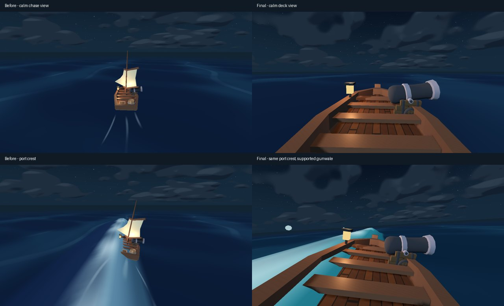

# Deck camera and turbulence implementation

Technical implementation and regression checks completed, 2026-10-18
(Pacific/Auckland). Browser performance acceptance and human playtesting remain open.

Base: `4f464ecc44ca3df609a4125c7fd050874e3aa85b` (fresh origin/main).
Branch: `codex/turbulence-deck-camera`. Engine: Godot 4.8.dev7.c971f93e7;
Compatibility renderer; target viewport 1280 x 720.
Subsequently integrated `origin/main` at `96e14a3255b88e66f2f30a15cd72e535d4f95c29`
(hold-E controls), merge checkpoint `fe6134e`.

Player experience: stand on the wooden deck, see the lantern left and the real
cannon right, and feel directional crests lift, bank and settle the hull.
Camera-only motion must carry this experience before adding synchronized effects.

The approved [implementation plan](TURBULENCE_CAMERA_IMPLEMENTATION_PLAN.md)
is the acceptance contract. Preserve four physical waves, scheduled heights,
force/yaw limits, countersteering, finite encounters/recovery, five-point
flotation, actual-motion wakes, projectile contacts and current controls.

Overlap checked: [draft PR #3](https://github.com/kickflip-games/ludum_dare_60/pull/3)
by avivajpeyi landed during implementation. Its hold-E aiming, F firing,
0.8-second sextant focus and held sailing restart are integrated and preserved.
The earlier separate E-glance requirement is superseded by those upstream controls.

## Implementation and settings

- `crossing.gd` remains the camera coordinator. `HelmEye` is authored at
  `(0, 2.05, 0.45)` on the actual visual hull pivot; hull heave is added once.
  Base pitch is -7 degrees; FOV is 74 degrees plus up to 3 degrees for speed.
- `deck_camera_response.gd` follows wave pitch/roll at 0.78/0.52 and sailing
  trim at 0.25/0.12. Exact critically damped springs use position/angular rates
  18/13 per second and impact rate 10. Vertical lag is capped at 0.14 m;
  impact compression/lateral offsets at 0.13/0.10 m, angular kick at 0.035 rad.
  Actual heading remains authoritative. Gaps over 0.25 s and teleports over 12 m
  discard history. All offsets precede final water/terrain clearance.
- Each active wave keeps one peak/descent contact record. Peak above 0.28 m,
  remaining height above 0.12 m and filtered descent below -0.32 m/s produce
  one compression and a shared ID/direction/strength event. No random wave shake.
- The existing licensed hull, lantern and actual firing cannon are retained.
  The oversized sail/boom is stowed because it obstructed incoming crests in
  the first rendered deck prototype. One fitted, procedural planked floor and
  lantern cage improve close detail. The open hull renders its inboard wood;
  light damage includes an inboard gunwale cut. No duplicate hull or fake cannon.
- A late close-view check exposed high-side gunwale immersion before the centre
  rose. The same five-point flotation now supplies at most 0.35 m extra visual
  edge support, with the existing damping/tilt limits. At the controlled 2.8 s
  port crossing, outer gunwale clearance improves from -0.212 m to +0.050 m.
  This does not lift or rotate the collision root or change wave pressure.
- One 52-instance MultiMesh supplies two 18-droplet impact bursts plus sixteen
  decorative crest flecks. Low uses ten droplets per burst and no crest flecks.
  A single subtle peripheral overlay leaves the centre clear. The same contact
  events trigger the existing generated audio resources, with bounded playback
  and mute support. Precision modes fade these effects to 15%.
- Full/Reduced is a menu choice, preserved across retries. Reduced multiplies
  angles, impact displacement, speed-FOV influence and streaks by 0.28. Vertical
  boat attachment and every physical wave/steering parameter remain identical.
- Water uses the existing signed face/cap vertex data. A fixed region footprint
  blends turquoise faces and white caps during warning/active waves and fades
  through recovery. The four-event sampler is not repeated in the fragment shader.
- The isolated Web staging workflow now retains `addons/lite_terrain`, which
  the terrain's runtime script extends. The previous blanket addon exclusion
  produced a real export parse error; editor automation and tests stay excluded
  from the release. Matching official 4.8.dev7 single-thread Web templates were
  obtained for this local build without installing another engine.
- Browser startup also exposed the existing ambient generator's unsupported
  default sample playback. It now explicitly uses streaming playback; contact
  sounds remain short generated WAV resources.

## Requirement-to-evidence record

| Requirement | Trigger and observed result | Evidence |
| --- | --- | --- |
| Deck composition and coherent attachment | Calm at four headings: deck below horizon, lantern left, real cannon right; eye stays within 0.16 m of marker; strong port crest keeps the gunwale clear | Sailing camera 28/28; native deck/gun/sighting captures; new edge-support check |
| Camera-only directional weight | 1.85 m fixed-hull frontal/port/starboard/oblique crossings, effects absent: front lift 1.87 m, side lift 1.77 m, side roll 5.96 degrees, opposite bank signs | Turbulence camera 37/37; effects-off recorded sequence and pose traces |
| Inertia, deduplication and recovery | One compression per crest, four records/events at maximum; impulse and attitude settle; 30/60/120 Hz extrema agree | Same 37-check suite; gap, teleport and two retry controls |
| Full/Reduced | Side roll 5.96 -> 1.67 degrees, lift remains 1.78 m; working menu selection persists on retry; identical actual movement with matching steering and initial hull transform | Camera and effects suites |
| Bounded synchronized effects | Shared wave ID creates struck-side spray; 100 repeated four-event submissions retain two burst slots, 52 instances and constant node count | Effects 13/13, including Low cap, expiry, isolation toggles and two retries |
| World-anchored rough water | Moving boat/mesh does not move the region footprint; recovery fades the envelope | Effects suite; native wave/recovery captures |
| Wave authority and counterplay | Original wave geometry, forces and encounters remain unchanged; visual flotation gains bounded edge support; sampler matches real GPU within 0.000198 | 51,840 GPU comparisons, limit 0.001; wave 33/33; dynamic response 17/17 |
| Mode/input/navigation preservation | Integrated hold-E/F/Space and steering contracts, live guiding rays, faster sighting and held restart | Cannon 79/79; stargazing 123/123; HUD 59/59; controls lifecycle 46/46 |
| Clearance and lifecycle | Four overlapping maxima, actual terrain sphere sweep/near plane, shores, focus/terminal states and repeated retry | Camera 28/28; cannon/stargazing; effects reset checks |
| Damage and complete routes | Scratches/repairs remain health-derived; both input-driven physical routes reach harbour | Damage 38/38; archipelago 65/65; ocean 40/40 |

**578 checks pass across twelve headless suites** (37 + 13 + 33 + 40 + 17 +
28 + 79 + 123 + 38 + 59 + 65 + 46), after upstream integration and the edge-support
adjustment. Baseline suites passed before production edits.
The new camera test initially sampled the port crest before its leading face
arrived; its window now follows the analytic entry time (2.61 s) and samples
the developed incoming face at 2.75-2.85 s. Its direction/magnitude gate was retained.
Obsolete whole-ship/zero-roll assertions were replaced with explicit deck-view
contracts; unrelated clearance, collision, control and convergence gates remain.
The physics A/B fixture also resets the complete hull basis between trials:
Euler-only reset preserved tiny scale drift from preceding staged turns. The
strict 0.00001 comparison passes from identical initial transforms.

Native device: Intel(R) Graphics, OpenGL 3.3 driver 32.0.101.6651,
Compatibility, 1280 x 720. Raw logs, 800-frame directional sequences, poses and
clips remain under ignored `artifacts/water_review/turbulence_camera/`.

The pre-integration rendered, normal-control voyage reached harbour in **225.57 simulated
seconds**, with **2/3 hull**, **zero shore impacts**, and **20 waves in two completed
ten-crest encounters**. The same controlled oblique wave displaced an unsteered
boat **30.95 m**, versus **3.63 m** with real steering actions. The voyage fixture
runs eight simulation ticks per rendered frame; its timings are not a normal
gameplay performance benchmark.

Local motion evidence: [eight-second before/after comparison](turbulence_camera/before-after.gif)
and [camera-only port crossing](turbulence_camera/camera-only.gif), recorded before
the final edge-support adjustment. Native review
inspected recorded frame progressions and pose traces, including calm, each side,
frontal/oblique/four-wave impacts, real cannon, sighting and recovery. Both complete
physical routes also pass on the final integrated code; the long rendered voyage
was not repeated after the visual edge adjustment.

## Limits and pending acceptance

Partial browser measurements used Chrome/155.0.0.0 in the in-app browser,
WebGL 2, Intel Core Ultra 7 155U / Intel Graphics, Balanced power, 1280 x 720.
The measured presentation build was `93d3432`, before the final visual edge
support and upstream controls integration. Each row below is one completed
10 s warmup + 30 s sample, not the requested three repeats.

| Final-build scenario | Median / p95 / p99 frame interval (ms) | Frames >33.3 ms | Peak effects |
| --- | --- | --- | --- |
| Low, calm | 16.7 / 21.3 / 27.6 | 3 / 1783 | 0 |
| Low, four waves | 16.7 / 22.3 / 27.6 | 2 / 1766 | 20 |
| Standard, calm | 16.7 / 27.3 / 111.0 | 45 / 1521 | 0 |
| Standard, four waves | 17.3 / 143.6 / 206.0 | 120 / 1091 | 52 |

These partial samples were interrupted for integration/asset-import work and
then paused by the user. Later Standard samples include substantial desktop/import
interference. They do **not** establish sustained 60 fps or the 30 fps fallback
target. Baseline/final node counts stayed at 575/600 after warmup, including repeated
wave cycles; Web static-memory reporting returned zero (unavailable). No recording
or screenshot readback ran in the timed sample loops. The final three-repeat,
quiet-desktop benchmark and browser focus/resume audit remain uncompleted, as
requested when wrapping up quickly. Raw partial records remain in the ignored
review directory.

`tools/turbulence_web_review.py --prepare --godot PATH --templates DIR` prepares
separate baseline/final development exports plus a clean release ZIP. It refuses
to overwrite existing staging folders and checks engine diagnostics. `--serve`
starts the optional localhost result collector for a later full benchmark.
The final tool was executed successfully against integrated main `96e14a3` and
the final working tree. All three isolated exports imported/exported without
script or engine errors. The release excludes development fixtures and editor
automation; the local distributable is `build/turbulence-wrap/latitude-lines-web.zip`
(14,155,087 bytes). Final rendered calm, cannon-entry/fire, sighting, frontal,
port/starboard, oblique, four-wave and recovery captures are in
`turbulence_camera/wrap-final/`; cannon metadata confirms one actual fired shot.
The tracked comparison image above was refreshed from these final captures.

The supplied generated video and its sampled contact sheet were available and
inspected as the composition/motion target. This reproduces observable deck,
directional lift/bank/recovery, turquoise faces and contact feedback; it does
not reconstruct the generated clip's camera transforms. The existing hull
keeps its benches and stylized cannon, rather than duplicating the reference art.
The largest waves can visibly wash across an edge of this open boat; no flooding
or damage mechanic was introduced. Bow wash sheet and FOV impact pulses were
not added: contact spray and camera motion already carry those optional cues.

Subjective motion comfort, fun, balance and a human comparison
with the reference remain pending; automated routes cannot establish them.

Export constraints were checked against the
[official Godot Web documentation](https://docs.godotengine.org/en/latest/tutorials/export/exporting_for_web.html).
The local build uses Compatibility/WebGL 2, matching 4.8.dev7 templates and
single-thread export. No compute simulation, SSR, motion blur or GPU readback
was added to production.
